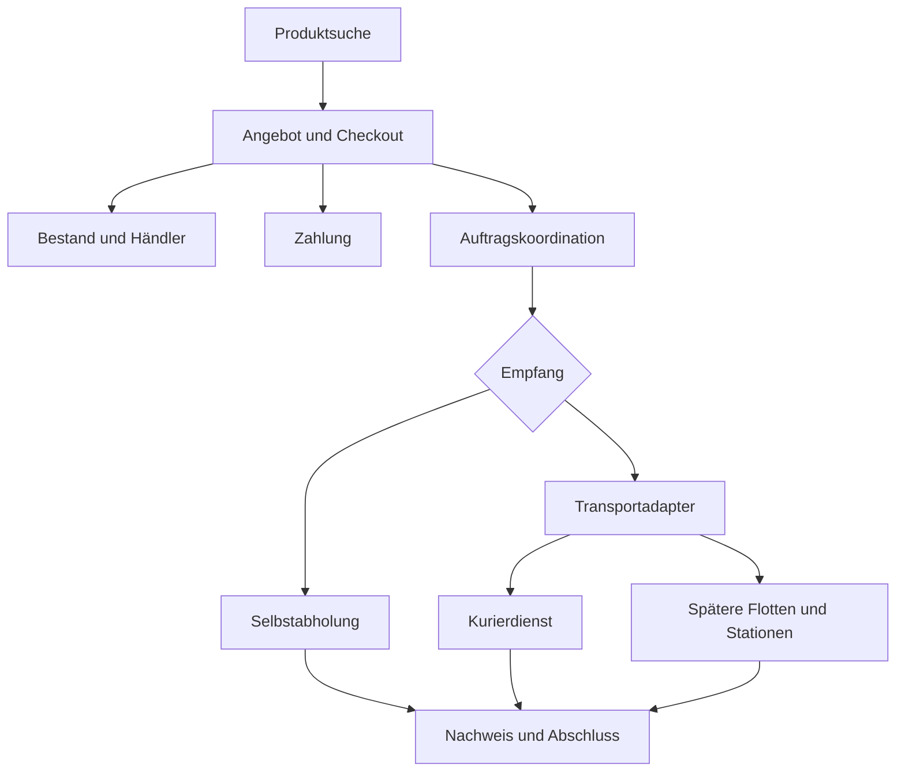

# Lokale Lieferplattform – Architektur

Stand: 2026-10-21 · **Entwurf / Vorschlag**, sofern nicht ausdrücklich anders markiert.

Die lokale P0-Pitch-Implementierung ist gesondert in Abschnitt 13 dokumentiert. Die Abschnitte 1–12 bewahren die weitergehenden Entwürfe; ihre Pilot-/Sicherheitsverfahren sind nicht implementiert. Die Bilder unter `assets/pitch/` sind Konzeptvisualisierungen. Keine Flugkorridore, Höhen oder Betriebsverfahren genehmigt oder sicherheitstechnisch nachgewiesen. Fachliche Anforderungen und Quellenregister: [Konzept.md](Konzept.md). Arbeitsregeln: [AGENTS.md](AGENTS.md).

## 0. Plattformarchitektur und Integration der Gruppenunterlagen

**Vorschlag übernommen am 2026-10-21, nicht implementiert:** Bestellplattform als responsive Web-App/PWA mit Modulen für Identität, Katalog, Bestand, Checkout, Bestellung, Zahlung, Vorbereitung, Lieferung, Nachrichten und Support. Die übernommene technische Detailplanung steht in Abschnitten 9–12. Fachliche Stufen und Annahmen: [Konzept.md, Abschnitt 1](Konzept.md#1-problem-und-ziel).

**Abgrenzung:** Abschnitte 1–8 beschreiben den erhaltenen Drohnen-/Stationsentwurf für A3. Die Gesamtflugfreigabe aus Abschnitt 4 ist unabhängig von Bestell-/Zahlungsbestätigung. P0/M1 verwenden einen Kurieradapter; Selbstabholung benötigt keinen DeliveryJob. Die Plattform steuert keine Drohne direkt. Ein späteres Stationsereignis beendet gegebenenfalls die Transportetappe, nicht automatisch den Kundenempfang.

**Geltung:** Die gelieferten Vorlagen sind unter [docs/grundlagen](docs/grundlagen/README.md) archiviert. Die Kapitel 12–15 der Markdown-Vorlage wurden als technische Vorschläge in die Abschnitte 9–12 übernommen; Änderungen werden hier und im Konzept gepflegt. Kapitel 16 bleibt eine Startprompt-Vorlage für eine spätere ausdrückliche Beauftragung. Kein Dokumenttext aktiviert selbstständig Entwicklung oder Echtbetrieb. Demo-Fristen und Beispielsummen sind keine Betriebsgrenzen. Die Kennzeichnung „P0“ in der Vorlage bezeichnet eine Stufe; P0/P1 in der alten K-Tabelle sind Prioritäten des Drohnenteilkonzepts.


Dieser Teil konkretisiert die empfohlenen Produktentscheidungen für ein Coding-System. Interne Namen sind englisch, die Oberfläche ist deutsch. Angaben wie Fristen oder Seed-Daten sind Entwicklungsvorgaben, keine validierten Betriebszusagen. Bei Abweichungen gilt die Fachlogik dieses Dokuments; Änderungen daran sind in einem Entscheidungsprotokoll festzuhalten.

### Architekturentscheidung

Bei einem vorhandenen Repository dessen Stack beibehalten. Ohne vorhandenen Anwendungsstack lautet der Vorschlag: TypeScript, Next.js für responsive Oberfläche und Server-Endpunkte, PostgreSQL für Geschäftsdaten und Migrationen. Geografische Suche kann mit PostGIS ergänzt werden. Eine einzige Anwendung mit fachlich getrennten Modulen ist der Ausgangspunkt. Native Apps, Microservices und eine eigene Navigationsengine gehören nicht zum ersten Auftrag.

Die Module heißen `identity`, `catalog`, `inventory`, `checkout`, `orders`, `payments`, `fulfillment`, `delivery`, `notifications` und `support`. Ein Hintergrundprozess verarbeitet die Outbox, ablaufende Reservierungen und Ereignisse externer Anbieter. Kritische Geschäftsregeln laufen auf dem Server. Der Browser übermittelt Absichten, keine verbindlichen Preise oder Zustände.

Provider-Verträge für `InventoryProvider`, `DeliveryProvider`, `PaymentProvider` und `NotificationProvider` werden zuerst mit deterministischen Demo-Adaptern implementiert. Ein späterer `LockerProvider` ergänzt Stationszugriff. Echte Zugangsdaten werden nicht benötigt, um den Bestellablauf zu entwickeln. Mock und Echtbetrieb bleiben in Oberfläche, Konfiguration und Daten klar erkennbar.

### Fachliche Aufteilung



Das Diagramm beschreibt Verantwortungsbereiche, keine zeitliche Aufrufreihenfolge. Die Bestätigungsbedingungen aus [Konzept.md, Abschnitt 1.4](Konzept.md#14-bestellablauf-und-geschäftsregeln) und Abschnitt 10 gelten auch für diesen Entwurf.

## 1. Komponenten und Verantwortlichkeiten
| Komponente | Vorgesehene Aufgabe |
|---|---|
| Auftragsverwaltung | Paketdaten, Status, Empfängerberechtigung und eindeutige Zuordnung verwalten |
| Missionsplanung | Route, Zeitfenster, Fahrzeug, Nutzlast, Energie und Alternativen zusammenführen |
| Routen-/Luftraummodell | Korridore, Ebenen, Kreuzungen, Kapazitäten und zeitabhängige Einschränkungen abbilden |
| Wetteradapter / Bewertung | Beobachtungen und Vorhersagen beziehen, Qualität prüfen, missionsbezogen bewerten |
| Freigabedienst | Pflichtprüfungen zusammenführen und begründete, zeitlich begrenzte Entscheidung dokumentieren |
| Flottenbetrieb / Flugaufsicht | Fahrzeugzustand, Missionsüberwachung, Eskalation und betriebliche Verantwortung |
| Drohne / lokale Steuerung | Flugführung, Telemetrie und nachzuweisende lokale Sicherheitsverfahren |
| Stationssteuerung | Landebereich, geschützte Übergabe, Paketfächer, Zugang und Ladeplätze überwachen |
| Energie / Wartung | Batteriegesundheit, Ladeplanung, Inspektionen und Einsatzsperren verwalten |
| Nutzerstatus / Audit | Verständlichen Status und Gründe anzeigen; Entscheidungen und Übergaben nachvollziehbar halten |

Organisatorische Rollen, Eingriffsrechte und Verantwortungsübergänge sind noch festzulegen. Die Software ersetzt keine erforderliche betriebliche Verantwortung.

## 2. Physische Struktur
Logistikstandort → festgelegter Korridor → geschützter Stationslande-/Übergabebereich → verschlossenes Paketfach → öffentlicher Abholbereich.

Lade- und Wartungsbereiche sind vom Publikum getrennt. Eine gesicherte mechanische Paketübergabe ist zu entwerfen; Fachzuordnung, Verriegelung, Paketnachweis und Drohnenfreigabe benötigen bestätigte Zustände. Ein fehlender Übergabenachweis darf keine erfolgreiche Zustellung erzeugen.

Standorte benötigen dokumentierte Hindernisprüfung einschließlich temporärer Änderungen. Reservestationen müssen zur Route, Energie, Nutzlast und aktuellen Lage passen; eine theoretisch vorhandene Station ist keine garantierte Alternative. Ladung versus Akkutausch, Ladezeiten, Netzanschluss und Brandschutz sind offene Auslegungsfragen.

## 3. Routen-, Höhen-, Geschwindigkeits- und Energiemodell
- Korridore bestehen aus gerichteten Segmenten mit Geometrie, Bezugssystem, Höhenbezug, Geschwindigkeitsbereich, Gültigkeit und Kapazität.
- Höhenebenen benötigen eindeutige Höhenreferenz; Gelände- und Hindernisabstände dürfen nicht aus uneindeutigen Höhenangaben abgeleitet werden.
- Ebenenwechsel, Kreuzungen und An-/Abflüge sind eigene zu prüfende Segmente. Abstände und Konfliktregeln hängen von Fahrzeug, Navigation, Umgebung und genehmigtem Betriebskonzept ab.
- Reservierungen berücksichtigen Zeit, Kapazität und mögliche Konflikte. Ein Reservierungskonzept allein ist kein Nachweis sicherer Flugtrennung.
- Energieplanung berücksichtigt Nutzlast, Wind, Temperatur, Batteriezustand, Steig-/Sinkflug, Wartezeiten, Rückflug/Weiterleitung und begründete Reserven.
- Abmessungen, Masse, Nutzlast, Geräuschdaten samt Messbedingungen, Geschwindigkeit, Reichweite und Wettergrenzen werden als versioniertes Fahrzeugprofil hinterlegt. Keine Zahlenwerte festgelegt.
- Die Hypothese unterschiedlicher Geschwindigkeiten je Höhe ist in Konzept.md als H01 geführt und noch nicht validiert.

### 3.1 Routing-Ablauf – Vorschlag zu R01–R14
1. Auftrag auf Vollständigkeit, Paketprofil, Ziel und Lieferfenster prüfen; fehlende Pflichtangaben begründet zurückweisen.
2. Kandidaten nach Drohnen-/Stationskompatibilität, Wartung und belegter zeitlicher Verfügbarkeit filtern. Position und Batteriestatus auf Aktualität prüfen.
3. Für jeden Kandidaten Bereitstellung zum Lager, Beladung, mögliche Bündelung, zulässige zeitabhängige Strecke und Rückflug/Weiterleitung planen. Nutzlast nach jeder Übergabe neu ansetzen.
4. Wetter, Luftraum, Energie inklusive Reserve/Alternative und Ressourcen für die gesamte Mission prüfen. Unbestimmte Pflichtwerte schließen einen Kandidaten von der Freigabe aus.
5. Unter machbaren Kandidaten früheste bestätigbare Übergabe vergleichen. Lieferfenster bestehender Aufträge schützen; Energie/Leerflüge als nachgeordnete Kriterien auswerten. Ergebnis ist eine Prognose; keine globale Optimalität behaupten.
6. Drohne, Flugslots, Landefläche, Fach und gegebenenfalls Ladeplatz konsistent reservieren. Scheitert eine Teilreservierung, übrige Reservierungen freigeben und neu planen. Parallele Planungen dürfen dieselbe Drohne nicht gleichzeitig binden.
7. Versionierte Mission an Gesamtfreigabe übergeben; unmittelbar vor Start aktuelle Zustände prüfen. Planänderungen entwerten die bisherige Freigabe für den geänderten Plan.
8. Fortschritt, Ankunftszeit und relevante Änderungen überwachen. Bei Störungen vorgeplante, situationsgerechte Verfahren anwenden; Übergabe erst nach Bestätigung buchen und Ressourcen anschließend freigeben.

**Zeitmodell:** Früheste Übergabe aus tatsächlichen Verfügbarkeits- und Reservierungszeiten ableiten, einschließlich Bereitstellung, Beladung, Laden, Flug und Übergabe. Parallel mögliche Tätigkeiten nicht doppelt addieren; notwendige Reihenfolge nicht überspringen. Für Bündelungen eine Prognose je Auftrag ausgeben.

**Algorithmuswahl offen:** Als späterer Prototypansatz eignet sich ein zeitabhängiger gerichteter Graph mit Kapazitäts- und Energiebedingungen. Kürzeste Entfernung allein genügt nicht. Mehrfachzustellungen erfordern zusätzlich eine Reihenfolgeplanung mit Zeitfenstern und veränderlicher Nutzlast. Konkreter Algorithmus erst nach Daten- und Umfangsfestlegung.

**Abgrenzung:** Zentrale Planung koordiniert die eigene Flotte. Erkennung und Behandlung unerwarteter Luftverkehrs-/Hinderniskonflikte brauchen nachgewiesene lokale Fähigkeiten und betriebliche Verfahren. Eine freie Reservierung bedeutet keinen freien Luftraum.

## 4. Wetterdaten und Entscheidung
### Datenumfang
Windgeschwindigkeit und -richtung, Böen, Niederschlag und Art, Gewitter/Blitzaktivität, Vereisungsrisiko, Temperatur und Sichtweite berücksichtigen. Abdeckung für Route, Start, Ziel und Ausweichstationen sowie vorgesehene Höhen prüfen. Fehlende Höhendaten nicht durch unbezeichnete Bodenwerte ersetzen.

Beobachtungen und Vorhersagen getrennt speichern. Erforderliche Metadaten: Quelle, Abrufzeit, Beobachtungs-/Ausgabezeit, Gültigkeitsintervall, räumliche/zeitliche Auflösung, Höhenbezug, Einheiten, Unsicherheit und Qualitätskennzeichen.

### Wetterzustände
| Zustand | Bedeutung |
|---|---|
| MÖGLICH | Alle erforderlichen Wetterkriterien für die geplante Mission mit belegten Grenzen erfüllt |
| EINGESCHRÄNKT | Nur mit expliziten, belegten Einschränkungen möglich; geänderte Mission erneut vollständig prüfen |
| NICHT_MÖGLICH | Mindestens eine relevante Wettergrenze verletzt |
| UNBESTIMMT | Erforderliche Daten fehlen, sind veraltet, widersprüchlich oder zu unsicher |

Bewertung umfasst das gesamte geplante Zeitfenster einschließlich Rückflug oder sicherer Weiterleitung. Grenzen, Aktualisierungsintervalle, maximale Datenalter und Unsicherheitstoleranzen müssen aus Datenquellen, Fahrzeugnachweisen und Betriebskonzept begründet werden. Sie sind noch offen.

### Gesamtflugfreigabe
Wetter ist eine von mehreren Pflichtprüfungen: Route/Luftraum, Energie/Reserve, Nutzlast, Wartungszustand, Stations-/Fachverfügbarkeit, Sicherheitsbedingungen und betriebliche Berechtigungen. Vorschlag für deren Ergebnisse: bestanden, nicht bestanden, unbestimmt.

Eine Freigabe erfordert alle Pflichtprüfungen als bestanden und die Umsetzung sämtlicher Wetterauflagen. Nicht bestanden oder unbestimmt verhindert eine automatische Freigabe. Entscheidungen enthalten Gründe, bewertete Mission, verwendete Daten-/Regelversionen und Ablaufzeit. Änderungen an Mission oder relevanten Bedingungen lösen eine Neubewertung aus.

Unmittelbar vor Start erneut prüfen. Während des Fluges relevante Änderungen überwachen. Wetterdienst-Ausfall ist kein Grund, einen bereits laufenden Flug blind abzubrechen: nachzuweisende situationsabhängige Verfahren entscheiden über Fortsetzung, Umleitung, Rückkehr oder sichere alternative Landung. Neue Starts erhalten ohne ausreichende gültige Daten keine positive Freigabe.

Nutzer sehen Status und Gründe; mögliche spätere Zeitfenster sind ausdrücklich Prognosen.

## 5. Datenmodelle – erste Struktur
| Modell | Kerninformationen |
|---|---|
| Paket / Auftrag | ID, Maße, Masse, Eignung, Ziel, Status, Referenz auf Abholberechtigung |
| Fahrzeugprofil | Version, Abmessungen, Masse, Nutzlast, Betriebsgrenzen, Energie-/Lärmnachweise und Quellen |
| Fahrzeugzustand | Zeitstempel, Position, Energie, Batteriegesundheit, Wartung, Kommunikationszustand |
| Station | Standort, Hindernis-/Prüfstand, Landebereich, Fächer, Ladeplätze, Zugangsstatus, Verfügbarkeit |
| Routensegment | Geometrie, Koordinaten-/Höhenbezug, Ebene, Geschwindigkeit, Kapazität, Einschränkungen, Gültigkeit |
| Wetterdatensatz | Parameter und Metadaten gemäß Abschnitt 4; Beobachtung/Vorhersage getrennt |
| Mission | Auftrag, Fahrzeug, Segmente, Zeitfenster, Reservierungen, Energieplan, Alternativen |
| Freigabeentscheidung | Mission-/Regelversion, Prüfergebnisse, Gründe, Datenreferenzen, Auflagen, Ablaufzeit |
| Übergabeereignis | Auftrag, Station/Fach, Zeitpunkt, bestätigte Sensor-/Verriegelungszustände, Ergebnis |
| Vorfall / Audit | Ereignis, betroffene Objekte, Zeit, Akteur, Maßnahme, Nachweis und Auflösung |

Zusätzlicher Routing-Datenbedarf (**Vorschlag**):
- Auftrag: früheste Bereitstellung, Lieferfrist, Priorität, zulässige Zielalternative und Bündelbarkeit; personenbezogene Adresse nur bei erforderlicher Direktzustellung.
- Fahrzeugzustand: nächste Verfügbarkeit, zugeordnete Mission, nutzbare Energie und Unsicherheit; Fahrzeugprofil mit Quellen für Verbrauch und Einsatzgrenzen.
- Station/Landeort: Drohnenkompatibilität, Geometrie/Höhenbezug, Freiräume, Zutritts-/Hindernisstatus und getrennte Kapazitäten für Landung, Fach und Laden.
- Luftraumeinschränkung: Quellreferenz, Geometrie, Unter-/Obergrenze mit Höhenbezug, Aktivierungsintervall, Bedingungen, Abruf-/Versionszeit und Auswertbarkeit.
- Reservierung: Ressource, Mission, Zeitintervall, Zustand, Ablaufzeit und Versionskennung; Bestätigung, Änderung und Storno.
- Mission: mehrere Aufträge und Stopps, Nutzlast je Abschnitt, Übergabeprognosen, geplante Endposition und nächste Verfügbarkeit.

Einheiten, Pflichtfelder, Aufbewahrungsfristen und konkrete Schemas noch nicht festgelegt. Personenbezogene Daten minimieren; Zugriff und Protokollierung rollenbezogen auslegen.

## 6. Schnittstellen und Datenfluss – Entwurf
1. Auftragsverwaltung übergibt Paketanforderungen an Missionsplanung.
2. Planung liest Fahrzeug-, Routen-, Luftraum-, Wetter- und Stationszustände und fordert Reservierungen an.
3. Freigabedienst bewertet einen versionierten Missionsstand; liefert Status, Gründe und Auflagen.
4. Betrieb übermittelt nur nach passender Freigabe eine Mission an die Drohne; lokale Steuerung und Stationssteuerung melden bestätigte Zustände zurück.
5. Telemetrie und externe Änderungen veranlassen bei Bedarf Neubewertung und betriebliche Eskalation.
6. Bestätigte Fachübergabe aktualisiert Auftrag und Abholstatus; Ereignisse und Entscheidungen fließen ins Audit.

Protokolle und Technologien sind offen. Schnittstellen benötigen Authentifizierung, Berechtigungsprüfung, Zeitstempel, Versionsbezug, Wiederholungsschutz und idempotente Verarbeitung. Reservierungen brauchen Ablauf-/Freigabeverfahren, damit doppelte Aufträge oder Verbindungsabbrüche keine Doppelbelegung erzeugen. Sensordaten und Befehle sind auf Plausibilität und Aktualität zu prüfen.

## 7. Fehlerbehandlung und Prüffälle – Entwurf
Alle folgenden Reaktionen sind zu konkretisieren und nachzuweisen. Keine davon wurde implementiert oder getestet.

| Fehlerfall | Vorgesehene Reaktion | Später zu prüfendes Ergebnis |
|---|---|---|
| Ungeeignetes Wetter | Start sperren/verschieben; während Mission situationsgerechtes Alternativverfahren | Keine Freigabe bei verletzten Grenzen; Gründe sichtbar |
| Fehlende/veraltete Wetterdaten | UNBESTIMMT; keine automatische positive Freigabe | Ausfall und veraltete Daten werden erkannt, kein positiver Standardwert |
| Geringe Akkureserve | Mission ablehnen oder neu planen; in der Luft zulässige sichere Alternative bewerten | Reserve einschließlich Alternativplan berücksichtigt |
| Volle Paketfächer | Keine Mission ohne bestätigte Kapazität; Verschiebung oder neue Zielplanung | Gleichzeitige Reservierungen führen nicht zur Doppelbelegung |
| Stationsausfall | Neue Anflüge sperren; erreichbare geprüfte Alternative oder Rückkehrverfahren | Veraltete Verfügbarkeit reicht nicht zur Landefreigabe |
| Blockierter Landeplatz | Keine Landung in blockiertem Bereich; begrenztes Warten nur mit ausreichender Reserve | Hindernis erkannt, alternative Handlung ausgelöst |
| Verbindungsverlust | Nachgewiesenes lokales Verfahren abhängig von Flugphase und Umgebung | Keine Abhängigkeit von ständig verfügbarer Cloud für notwendige Sicherheitsreaktionen |
| Unbefugter Zutritt | Gefährdende Stationsvorgänge verhindern/unterbrechen; Alarm und Flugreaktion situationsabhängig | Publikum erreicht keine laufenden Rotoren |
| Fehlgeschlagene Übergabe | Paket sichern, keine Erfolgsbuchung; Wiederholung nur bei sicheren Bedingungen, sonst Eskalation | Kein falscher Zustellnachweis, Paketort nachvollziehbar |
| Manipulation / falsche Abholberechtigung | Zugriff verweigern, Ereignis erfassen, bei Bedarf Betrieb sperren | Fach bleibt ohne gültige Berechtigung verschlossen |
| Routen-/Luftraumänderung | Betroffene Planung/Freigabe neu bewerten, im Flug vorgesehene Verfahren anwenden | Alte Entscheidung nicht ungeprüft weiterverwenden |

### Ergänzende Routing-Prüffälle – geplant, nicht ausgeführt
| Fall | Erwartetes Ergebnis |
|---|---|
| Nahe Drohne muss laden, weiter entfernte ist rechtzeitig bereit | Auswahl anhand vollständiger Übergabezeit, nicht allein Entfernung |
| Schnellster Kandidat verletzt Nutzlast-/Energiegrenze | Ausschluss vor zeitlicher Optimierung; begründete Alternative oder Ablehnung |
| Zwei Planungen reservieren gleichzeitig dieselbe Drohne/Station | Höchstens eine konfliktbehaftete Reservierung bestätigt; andere neu planen |
| Bündelung überschreitet Paketkapazität oder vorhandene Lieferfrist | Bündelung verwerfen; einzelne Lieferungen erneut bewerten |
| Temporäre Sperre beginnt während geplantem Segmentdurchflug | Zeitliche Überschneidung erkannt; keine Freigabe dieser Route |
| Luftrauminformation fehlt oder Höhenbezug ist uneindeutig | Pflichtprüfung unbestimmt; keine automatische Freigabe |
| Eigene Drohnen kreuzen gleichzeitig; fremdes Luftfahrzeug tritt ein | Planungskonflikt erkannt; zusätzlich eigenständiges lokales Sicherheitsverfahren erforderlich |
| Direktziel passt geometrisch, Personen betreten Landefläche | Keine Landung trotz bestätigter Sicherheitshinweise; Alternative nach Verfahren |
| Positionsdaten veraltet oder Navigation fällt aus | Keine neue Auswahl auf ungeprüfter Position; laufende Mission nach lokalem Verfahren |
| Umleitung ist zulässig, aber Reserve reicht nicht | Alternative ablehnen und erreichbares Verfahren bewerten; keine blinde Rückkehr |
| Teilreservierung oder Missionsübermittlung scheitert | Keine Doppelmission; sichere Zustandsklärung und Freigabe nicht benötigter Ressourcen |

## 8. Technische Entscheidungen, Umsetzung und Prüfung
**Festgelegt durch Nutzerauftrag:** Feste Routen/Höhenebenen als Konzeptbestandteil, wetterabhängige Bewertung, sichere Stationen und Ladeinfrastruktur. Konkrete Auslegung offen.

**Noch nicht entschieden für A3:** Drohnenplattform, Stationsmechanik, Flotten-Softwarestack, Sensorik, Kommunikationswege, Anbieter, Datenintervalle, Grenzwerte, Routingverfahren und Sicherheitsarchitektur.

**Historischer Stand vor dem Pitch-Auftrag:** Projektdokumentation und technische Planung für Plattform und Drohnenausbau integriert; damals kein Code und keine Simulation. Die inzwischen umgesetzte begrenzte P0-Demo steht in Abschnitt 13. Keine Hardwareanbindung.

**Prüfplan:** Nach Umfangsfestlegung Daten- und Regelvalidierung, Zustandsübergänge, Reservierungskonflikte und Fehlerfallmatrix prüfen. Ein späterer Simulator benötigt gekennzeichnete Eingaben, reproduzierbare Szenarien, Vergleichsversorgung und Sensitivitätsanalysen. Physische Schutzmaßnahmen, Flugverhalten, Lärm, Wettertauglichkeit und Genehmigung erfordern separate Nachweise.

**Bekannte Einschränkungen:** Nur ausgewählte regulatorische Quellen geprüft (Konzept.md, Q01–Q03); keine vollständige Rechtsprüfung, keine Einsatzorte oder Fahrzeuge ausgewählt, keine quantitativen Betriebsgrenzen und keine belastbaren Leistungs-/Sicherheitsaussagen möglich. Die Initialisierung wird ausschließlich auf Dokumentstruktur, Anforderungsabdeckung und interne Verweise geprüft.

**Dokumentprüfung 2026-10-21:** R01–R14 aus dem Konzept mit Ablauf, Datenbedarf und Fehlerfällen abgeglichen; Dateiverweise geprüft. Die weitergehenden technischen A3-/Pilot-Prüffälle waren zu diesem Zeitpunkt nur geplant. Der spätere gesonderte Implementierungsauftrag und seine tatsächlichen P0-Prüfungen stehen in Abschnitt 13.

## 9. Datenmodell der Plattform

Alle Tabellen erhalten IDs und Erstellungs- beziehungsweise Änderungszeitpunkte. Geld wird in kleinsten Währungseinheiten als Integer mit Währung gespeichert, Mengen im Pilot als positive ganze Stückzahlen. Zeitpunkte werden in UTC gespeichert und in der Zeitzone des Liefergebiets angezeigt. Zugangsdaten und Codes werden nicht im Klartext protokolliert.

| Objekt | Wichtige Felder | Beziehung oder Regel |
| --- | --- | --- |
| User und RoleGrant | authSubject, role, merchantId, storeId | Kunde, Händler, Kurier oder Betrieb; Rechte serverseitig und mandantenbezogen |
| Address | ownerId, postalAddress, coordinates, instructions | Bestellungen erhalten einen unveränderlichen Adress-Snapshot |
| Merchant | name, partnerStatus, settlementReference | Eine Organisation mit mehreren Filialen |
| Store | merchantId, address, timezone, openingHours, pickupHours, preparationMinutes, orderCapacity | Aktive Aufträge und Öffnungszeiten bestimmen die Annahme |
| ProductVariant | title, brand, GTIN, category, attributes, weight, dimensions, handlingRequirements | Eine konkrete Variante; unbekannte Maße erlauben keinen ungeprüften Drohnenversand |
| Offer | storeId, variantId, merchantSku, unitPrice, taxClass, deposit, active | Verkaufbares Angebot genau einer Filiale |
| InventorySnapshot | offerId, sourceAvailable, sourceVersion, observedAt, quality | Adapter vereinheitlicht die Bedeutung des Quellbestands |
| InventoryReservation | orderId, offerId, quantity, expiresAt, state, externalReference | Temporäre Reservierung wird nach Bestätigung zur Zuteilung |
| Cart und CartLine | userId oder sessionId, storeId, offerId, quantity, version | Im MVP eine Filiale pro Warenkorb |
| Quote | cartVersion, destinationHash, fulfillmentMode, serviceLevel, methodPolicy, priceBreakdown, etaWindow, expiresAt | Angebotsinhalt nach Erstellung unveränderlich |
| CheckoutAttempt | userId, idempotencyKey, requestHash, orderId, state | Derselbe Schlüssel mit identischen Daten liefert dasselbe Ergebnis |
| Order und OrderLine | customerId, storeId, status, priceSnapshot, addressSnapshot, offerSnapshot | Historische Preise und Produkttexte bleiben erhalten |
| MerchantTask | orderId, status, acceptedAt, readyAt, handoverAt | Physische Vorbereitung getrennt vom Bestellstatus |
| Payment und Refund | orderId, providerReference, amount, status, authorizationExpiresAt | Mehrere Versuche möglich; nur eine erfolgreiche Zahlung pro Checkout |
| DeliveryJob | orderId, providerId, courierId, method, status, etaWindow, destinationVersion | Für Selbstabholung wird kein Lieferauftrag erzeugt |
| CourierAvailability | courierId, vehicleType, payloadCapacity, availability, lastSeenAt | Veraltete Verfügbarkeit darf keine feste Zusage erzeugen |
| HandoverToken | purpose, subjectId, allowedActor, tokenHash, expiresAt, usedAt | Einmalige Freigabe für Übernahme oder Empfang |
| TrackingEvent | deliveryJobId oder orderId, providerEventId, type, occurredAt, receivedAt, actor | Append-only; externe Ereignisse werden dedupliziert |
| Review und SupportCase | orderId, authorId, target, rating oder reason, status | Nur berechtigte Beteiligte; Bewertung nach Abschluss |
| AuditEvent und OutboxEvent | aggregateId, eventType, payload, processingState | Zustandsänderung und ausgehendes Ereignis gemeinsam speichern |

Erweiterungen erst bei Bedarf als echte Tabellen anlegen: `Station`, `Compartment`, `CompartmentReservation`, `Shipment` für Eigenversand, `DeliveryLeg` für Teilstrecken, `RedirectRequest` für Umleitungen sowie `ReturnRequest` für Rücksendungen. Der Transportadapter wird so gestaltet, dass ein Auftrag später auf Kauf oder Eigenversand verweisen kann.

### Bestandsregeln

Für das Pilotmodell mit eigenem Onlinekontingent gilt: verfügbar = zugeteiltes Kontingent minus aktive Reservierungen minus bestätigte Zuteilungen. Eine Datenbanktransaktion mit Sperre beziehungsweise bedingtem Update verhindert negative Verfügbarkeit. Zwei Kunden dürfen den letzten Artikel nicht gleichzeitig reservieren.

Bei einem späteren externen Reservierungssystem legt der Adapter fest, ob dessen verfügbare Menge lokale Reservierungen bereits enthält. Dieselbe Reservierung darf nicht zweimal abgezogen werden. Jede externe Reservierung erhält eine Referenz; ältere Bestandsereignisse dürfen neuere Versionen nicht überschreiben. Ein lokaler Lock garantiert keine Synchronität mit der Ladenkasse.

Temporäre Reservierungen laufen nur während der ausstehenden Bestellung ab. Nach Bestätigung werden sie in eine dauerhafte Zuteilung umgewandelt. Nach Verkauf beziehungsweise Übergabe werden sie verbraucht. Bei Storno vor Übergabe können sie freigegeben werden; nach einer Rücksendung ist eine Warenprüfung nötig.

## 10. Zustände und Transaktionsregeln der Plattform

Ein einziges Feld wie `orderStatus = delivered` reicht für Zahlung, Vorbereitung und Transport nicht aus. Die UI erzeugt aus mehreren Zuständen eine verständliche Zeitleiste.

| Bereich | Normaler Ablauf | Abweichungen |
| --- | --- | --- |
| Bestellung | PENDING → CONFIRMED → FULFILLING → COMPLETED | REJECTED oder EXPIRED aus PENDING; CANCELLED über geprüften Stornoprozess |
| Vorbereitung | NEW → ACCEPTED → PICKING → READY → HANDED_OVER | REJECTED vor Bestätigung; danach Supportfall oder definierter Abbruch |
| Bestand | ACTIVE → ALLOCATED → CONSUMED | RELEASED oder EXPIRED; ALLOCATED läuft nicht durch den normalen Reservierungstimer ab |
| Zahlung | PENDING → AUTHORIZED → CAPTURE_PENDING → CAPTURED | FAILED, VOID_PENDING, VOIDED; unbekannt bleibt ausstehend bis zur Klärung |
| Erstattung | REQUESTED → PROCESSING → SUCCEEDED | FAILED mit Wiederholung oder Support; Zahlungsstatus CAPTURED bleibt historisch korrekt |
| Lieferung | CREATED → ASSIGNED → PICKED_UP → IN_TRANSIT → AT_DESTINATION → DELIVERED | FAILED, RETURNING, RETURNED; CANCELLED nur vor Übernahme |

Die Pfeile beschreiben zugelassene Übergänge, keine frei editierbaren Statuswerte. `PENDING` enthält die noch offenen Bestätigungen. `FULFILLING` umfasst Vorbereitung und Transport. Ein fehlgeschlagener Transport schließt den Auftrag nicht automatisch ab. Der Supportfall bleibt sichtbar, bis erneute Zustellung oder Rückführung und finanzielle Behandlung feststehen.

### Bedingungen für Bestätigung und Übergabe

1. Checkout legt Bestellung, Reservierungen und Outbox-Ereignis atomar an. Netzaufrufe werden außerhalb der Datenbanktransaktion ausgeführt.
2. Zahlungsautorisierung, Händlerannahme und gegebenenfalls Transportzusage müssen vor Ablauf der Fristen vorliegen. Selbstabholung benötigt keine Kurierzusage.
3. Vor Einzug nochmals prüfen, dass Reservierung und Transportzusage noch gelten. Zahlung mit stabilem Idempotenzschlüssel einziehen. Erst nach bestätigtem Einzug Bestellung auf CONFIRMED und Bestand auf ALLOCATED setzen.
4. Bei einem Fehler zwischen Einzug und lokalem Commit gleicht ein Hintergrundprozess den Providerzustand ab. Während CAPTURE_PENDING oder eines unklaren Einzugs ist die Reservierung vor dem normalen Ablauf geschützt, bis Erfolg oder sicherer Abbruch geklärt sind. Es gibt keinen zweiten Einzug und keine automatische Freigabe bezahlter Ware wegen eines bloßen Timeouts. Dauerhaft ungeklärte Fälle werden an den Betrieb eskaliert.
5. PICKING ist erst nach Bestätigung erlaubt. READY plus CAPTURED plus zugeordneter Empfänger sind Voraussetzung für eine Übergabe. Bei Selbstabholung ist der Empfänger der Kunde.
6. Bei Lieferung schließen DELIVERED und gültiger Empfangsnachweis die Bestellung ab. Bei Selbstabholung genügt die dokumentierte Übergabe an den Kunden. Ein digitaler Code wird einmal eingelöst und anschließend abgewiesen.
7. Für spätere Stationen kommen AT_STATION und COLLECTED hinzu. Einlagerung beendet die Transportetappe, Kundenabholung erfüllt den Warenempfang. Fristablauf startet Rückführung statt einer erfundenen Abholung.

### Fehler und Abbruch

Vor Einzug: Reservierung und Kapazität lösen, Autorisierung aufheben und Kunden informieren. Nach Einzug: getrennten Erstattungsauftrag erstellen; Status bis zum tatsächlichen Ergebnis anzeigen. Nach Paketübernahme: zunächst Transport stoppen oder Rückführung vereinbaren, keine automatische Bestandsfreigabe.

Das MVP erlaubt einen direkten Stornoantrag, solange noch nicht PICKING begonnen hat. Danach entscheidet ein Supportablauf anhand des tatsächlichen Zustands. Diese Produktregel ersetzt keine anwendbaren Kundenrechte und ist vor Livebetrieb mit der Vertragsgestaltung abzugleichen. Kein Endpunkt darf eine Bestellung durch beliebiges Setzen von `status` umgehen.

## 11. Schnittstellen für das MVP

Die folgenden Pfade sind ein implementierbarer Vorschlag. Für alle Schreibaktionen gelten Authentifizierung, Rechteprüfung, Eingabevalidierung und ein protokollierter Akteur. Ausnahmen sind ausschließlich signierte Provider-Webhooks. Browser-IDs sind niemals ein Berechtigungsnachweis.

| Methode und Pfad | Zweck | Kernprüfung |
| --- | --- | --- |
| GET /api/catalog/search | Angebote nach Begriff, Radius und Filtern | Öffentliche Angebotsdaten, keine internen Bestände oder Privatadressen |
| GET /api/offers/:id | Variante, Filiale, Preis, Aktualität | Aktives Angebot und zulässige Datenfreigabe |
| PUT /api/cart | Positionen und Mengen ändern | Eine Filiale, gültige Mengen, Versionsprüfung |
| POST /api/quotes | Abholung und lieferbare Optionen kalkulieren | Aktueller Warenkorb, Ziel, Kapazität und Eignung |
| POST /api/checkout | Quote in ausstehende Bestellung überführen | Idempotenz, Ablaufzeit, Bestand, Nutzer und Preis-Snapshot |
| GET /api/orders/:id | Bestellung und Zeitleiste | Kunde, zugehöriger Händler oder berechtigter Betrieb |
| POST /api/orders/:id/cancel-requests | Storno beantragen | Zustand, Eigentümer und Rückabwicklungsregeln |
| POST /api/merchant/orders/:id/accept | Ware und Vorbereitungszeit bestätigen | Filialberechtigung, offene Frist und ausreichende Ware |
| POST /api/merchant/orders/:id/reject | Auftrag ablehnen | Grund und noch zulässiger Zustand |
| POST /api/merchant/orders/:id/start-picking | Zusammenstellen starten | Bestätigte Bestellung und Filialberechtigung |
| POST /api/merchant/orders/:id/ready | Abholbereit melden | Bestätigte Bestellung und abgeschlossene Vorbereitung |
| PUT /api/courier/availability | Einsatzstatus und Fahrzeug melden | Eigener Kurier, aktuelle Kapazität |
| POST /api/ops/jobs/:id/assign | Kurier verbindlich zuordnen | Kein Doppelauftrag, Paket geeignet, Kapazität verfügbar |
| POST /api/jobs/:id/pickup | Paketübernahme bestätigen | Zugeordneter Kurier und gültiger Händler-Übergabecode |
| POST /api/jobs/:id/deliver | Empfang bestätigen | Zulässiger Lieferzustand und gültiger Kunden-Empfangscode |
| POST /api/orders/:id/collect | Selbstabholung abschließen | Filialmitarbeiter, Kunde, Code, READY und CAPTURED |
| POST /api/orders/:id/reviews | Bewertung anlegen | Eigentümer und abgeschlossene Bestellung; Ziel getrennt speichern |
| POST /api/webhooks/:provider | Providerereignis übernehmen | Signatur, Ereignis-ID, Schema und zeitliche Plausibilität |
| POST /api/ops/refunds | Erstattung auslösen | Supportrecht, Betrag, Grund und keine doppelte Erstattung |

Listen für Händler, Kuriere und Betrieb verwenden dieselben Berechtigungsregeln. Zuweisung, Vorbereitung und Codeausgabe werden als kontrollierte Domain-Aktionen ergänzt, nicht als frei zugängliche Tabellenänderungen.

### Vertrag eines Lieferangebots

Das Beispiel ist vollständig fiktiv; Preis und Zeit sind keine Geschäftszusage. `validForSeconds` wird bei Erstellung serverseitig in `expiresAt` umgerechnet. Die zwei Zeitwerte bilden ein Ankunftsintervall ab Bestellung.

```json
{
  "quoteId": "demo_quote_001",
  "cartVersion": 3,
  "fulfillmentMode": "HOME_DELIVERY",
  "serviceLevel": "STANDARD",
  "methodPolicy": "AUTO_WITHIN_ACCEPTED_OPTIONS",
  "selectedMethod": "BICYCLE",
  "currency": "EUR",
  "itemsSubtotalMinor": 2490,
  "deliveryFeeMinor": 390,
  "serviceFeeMinor": 0,
  "totalMinor": 2880,
  "etaFromMinutes": 25,
  "etaToMinutes": 40,
  "validForSeconds": 120,
  "availability": "AVAILABLE",
  "isDemo": true
}
```

Für Selbstabholung sind Transportmethode und Liefergebühr leer beziehungsweise null Euro; die Zeitanzeige beschreibt Abholbereitschaft. Ein späteres Terminfenster wird als `requestedWindowStart` und `requestedWindowEnd` gespeichert. Für nicht verfügbare Optionen liefert der Server einen verständlichen Grund, zum Beispiel `OUT_OF_AREA`, `NO_CAPACITY`, `STORE_CLOSED`, `STOCK_UNCONFIRMED`, `PACKAGE_UNSUPPORTED` oder später `WEATHER_UNSAFE`.

Fehlerantworten enthalten `code`, `message`, `retryable` und `correlationId`. HTTP 409 gilt etwa bei Bestand, Warenkorbversion oder Idempotenzkonflikt; 422 bei unzulässiger Kombination; 403 bei fehlender Berechtigung. 202 bedeutet, dass eine asynchrone Aktion noch aussteht. Ein wiederholter identischer Checkout liefert die bereits erzeugte Bestellung.

## 12. Entwicklungsaufgaben mit Abnahme

Jede Aufgabe soll als kleiner, prüfbarer Schritt implementiert werden. Zuerst ein vollständiger Ablauf von Suche bis Empfang; zusätzliche Lieferarten folgen erst nach diesem Durchstich.

| Ticket | Ergebnis | Abnahme | Abhängigkeit |
| --- | --- | --- | --- |
| B01 Basis und Demo | App-Shell, deutsche Texte, Hell/Dunkel, Seed-Daten | Startanleitung funktioniert; Demo-Modus ist erkennbar | Keine |
| B02 Katalog und Suche | Angebote, Varianten, Filter, Filialvergleich | Suche ohne Standortfreigabe; Radius und Variante stimmen | B01 |
| B03 Konto und Daten | Migrationen, Authentifizierung, Rollen und Adressen | Kunde A kann Auftrag von B auch per API nicht lesen | B01 |
| B04 Warenkorb und Quote | Ein-Filial-Warenkorb, Abholung, Preis und ETA | Ziel- oder Warenkorbänderung verwirft alte Quote | B02, B03 |
| B05 Checkout und Bestand | Reservierung, Auftrag und Idempotenz | Zwei gleichzeitige Käufe der letzten Einheit ergeben höchstens einen Erfolg | B04 |
| B06 Händler und Zahlung | Annahme, Ablehnung, Capture, Ablauf und Refund | Keine Bestätigung vor allen Bedingungen; Ablehnung gibt Ressourcen frei | B05 |
| B07 Kurier und Empfang | Zuweisung, Übernahme, Tracking und Codes | Nur zugeordneter Kurier; Code nur einmal; Abholung ohne Kurier möglich | B06 |
| B08 Konto und Support | Historie, erneute Bestellung, Bewertung, Problemfall | Neue Bestellung nutzt neue Preise; Bewertung nur nach Abschluss | B07 |
| B09 Störungen und Betrieb | Outbox, Webhook-Prüfung, Wiederholung, Monitoring | Duplikate und vertauschte Ereignisse verfälschen keinen Endzustand | B06, B07 |
| B10 Pilotanbindung | Ein realer Bestandspartner, Zahlungsdienst und Kurierbetrieb | Durchgängiger beaufsichtigter Auftrag inklusive Rückabwicklung | B08, B09 und Partnerfreigaben |

P0 kann mit Demo-Identitäten beginnen. Spätestens B03 werden Berechtigungen tatsächlich serverseitig durchgesetzt. Ein bloßer Rollenschalter ist nur im klar abgegrenzten Entwicklungsmodus zulässig.

### Kritische Abnahmeszenarien

1. Ein Kunde findet einen Artikel in zwei Filialen; der Vergleich verwechselt die Variante nicht und unterscheidet Warenpreis und Gesamtpreis.
2. Ein Artikel einer zweiten Filiale wird nicht stillschweigend in den bestehenden Warenkorb aufgenommen; Wechsel oder separater Warenkorb wird erklärt.
3. Veralteter Bestand wird als unbestätigt angezeigt und erzeugt keine verbindliche Sofortzusage.
4. Zwei Checkouts für die letzte Einheit konkurrieren tatsächlich in getrennten Transaktionen; es entstehen keine negativen Bestände.
5. Doppelklick und Netzwerk-Wiederholung erzeugen eine Bestellung und höchstens einen erfolgreichen Einzug.
6. Eine abgelaufene Quote, geänderte Menge oder neue Lieferadresse verlangt eine Neuberechnung und erneute Zustimmung.
7. Händlerabsage, Fristablauf und fehlender Kurier lösen Reservierung und Autorisierung zuverlässig; eine bestätigte Zuteilung läuft nicht versehentlich ab.
8. Ein unbekannter Zahlungsstatus sperrt die Übergabe. Ein später Erfolg wird abgeglichen, ohne doppelte Belastung.
9. Selbstabholung funktioniert ohne DeliveryJob und ohne Liefergebühr, aber mit Vorbereitung und Empfangsnachweis.
10. Ein nicht zugeordneter Kurier kann weder die Zieladresse abrufen noch das Paket übernehmen.
11. Falscher, abgelaufener oder bereits verbrauchter Code wird abgewiesen; Zustellung ohne Nachweis wird nicht als erfolgreich angezeigt.
12. Doppelte oder verspätete Providerereignisse setzen DELIVERED nicht zurück auf IN_TRANSIT.
13. Kunde A, Händler A und Kurier A können fremde Aufträge weder lesen noch ändern; Erraten einer ID hilft nicht.
14. Ein Refund bleibt sichtbar ausstehend, bis der Zahlungsdienst Erfolg meldet; die Historie behauptet vorher keine erfolgte Rückzahlung.
15. Fehlgeschlagene Zustellung erzeugt einen bearbeitbaren Fall; Ware wird erst nach geprüfter Rückkehr wieder verfügbar.
16. Listen, Checkout und Tracking funktionieren auf einem kleinen Bildschirm, per Tastatur und mit lesbarem Hell- sowie Dunkelmodus.

Unit-Tests prüfen Preisberechnung, Zustandsregeln und Eignung. Integrationstests prüfen Transaktionen, Rechte, Outbox und Webhooks. End-to-End-Tests decken normale Lieferung, Selbstabholung und einen Abbruchfall ab. Tests sollen diese Risiken prüfen und nicht bloß Komponenten-Snapshots sammeln.

### Fiktive Daten zum Durchspielen

Seed: drei lokale Händler mit insgesamt vier Filialen, darunter ein Supermarkt; etwa 20 Varianten mit teilweise mehreren Angeboten; zwei Kunden; drei Kuriere mit Fahrrad, E-Scooter und Auto; ein Betriebsnutzer. Enthalten sind ein ausverkaufter Artikel, die letzte verfügbare Einheit, ein veralteter Bestand, eine geschlossene Filiale, ein zu großes Paket und ein Ziel außerhalb des Gebiets.

Demo-Konfiguration: Quote 120 Sekunden, offene Bestandsreservierung 5 Minuten, Händlerantwort maximal 3 Minuten. Fristen dürfen für die Vorführung beschleunigt werden und müssen über eine kontrollierbare Uhr testbar sein. Für einen echten Pilot werden die Werte anhand der Partnerprozesse festgelegt. Auch die ETA-Spanne von 25 bis 40 Minuten aus dem Beispiel ist ausschließlich ein Testwert.


**Integrationsprüfung 2026-10-21:** Datenmodell, Zustandsregeln, API-Vorschläge, B01–B10 und alle 16 Abnahmeszenarien aus der gelieferten Markdown-Vorlage übernommen. Szenarien sind geplant, nicht ausgeführt. Originale und weitere Produktdetails siehe [Grundlagen](docs/grundlagen/README.md).


## 13. Implementierte P0-Pitch-Demo

**Beschlossen / implementiert, 2026-10-21:** Abgegrenzter Umfang in [Konzept Abschnitt 12](Konzept.md#12-beauftragte-erste-pitch-version--lokale-wuppertal-demo). Stack: React 19, Next.js 16 App Router, TypeScript, CSS Modules, Leaflet 1.9.4, Vitest und Playwright. Lokale Node-Anwendung; kein Hosting und keine Geschäftsdatenbank.

### Komponenten und Datenfluss
- `src/domain/catalog.ts`: fiktive Händler, 7 Filialen, 36 Varianten/40 Angebote und Suche.
- `checkout.ts`: ganzzahlige Cent-Preise, Ein-Filial-Prüfung, Menge/Bestand, Modus und 120s-Demo-Quote.
- `orders.ts`: sitzungslokaler idempotenter DemoOrderService, getrennte Bestell-, Demo-Zahlungs-, Vorbereitungs- und Lieferzustände. Keine reale Autorisierung oder Abbuchung; Ankunft ist ein eigener Zustand vor Empfang.
- `routing.ts`: gerichtetes Dijkstra-Netz, Szenarien, Verfügbarkeits-/Stationsprüfung, getrennte Hin-/Rückwegzeiten. Keine Energie-, Hindernis- oder Flugtrennungsnachweise.
- `src/demo/`: vorbereitete Beispielrouten, Interpolation, versionierte defensive Sitzungswiederherstellung.
- `src/components/`: echte interaktive App-Komponenten, Karten/Netz, Warenkorb/Dialoge, Zeitleisten und Vorhersagedetails. Pitch-Uhr mit Pause, manuellen Schritten und unterbrochener Fortschaltung bei verstecktem Tab. Reduzierte Bewegung nach Betriebssystem.
- `src/weather/` und `src/app/api/weather/route.ts`: Providervertrag, Whitelist fester Orte, Normalisierung, prozesslokaler Servercache und Fehlerbehandlung. Browser fragt nur konfigurierte IDs ab. Kein allgemeiner Proxy; keine Schreib-API.

Die Datensätze kennzeichnen Demo-Inhalte und Online-/Cache-Vorhersagen. Browser-Speicher ist keine Authentifizierung, keine Datenbank und keine geräteübergreifende Reservierung. Jede WLAN-Teilnahme führt eine eigene Demo aus. Die Demo kann Bestände ausschließlich innerhalb einer Sitzung vergeben.

### Karten und Ausfälle
Karten beziehen reguläre OSM-Standardkacheln über Leaflet, sichtbar attribuiert, ohne Vorladen/Offline-Massendownload. Tilequelle und Attribution konfigurierbar. Bei Ladefehlern sichtbarer Hinweis, Wiederholung und schematisches Netz. Die Karte enthält fiktive Standorte und Beispielrouten, keine Navigation oder genehmigten Flugkorridore. Nach geladenen App-Modulen sind Szenarien lokal weiter bedienbar; ein vollständig neuer Offline-Erstaufruf wird nicht zugesagt.

### Wetter und Entscheidungsgrenze
MET Norway `/weatherapi/locationforecast/2.0/compact`; User-Agent identifiziert das reale Projekt-Repository und lässt sich konfigurieren. Vier Nachkommastellen, Cache mit Expires/Last-Modified und 304, gleichzeitige Anfragen zusammengeführt, begrenzte Wiederholungen, globaler 429-Cooldown, Timeout auch beim Response-Body. Die Browseroberfläche pollt nicht im Hintergrund.

24h-Fenster (inklusive angefangener Stunde gegebenenfalls 25 Punkte), UTC-Speicherung und Anzeige Europe/Berlin. Temperatur 2m, Wind 10m über Modellboden; kein Flugwetter in Flughöhe. Anbieteraktualisierung, Download/Cache-Prüfung, Prognosezeiten und Niederschlagsintervalle getrennt. Fehlende Böen/Sichtweite/Vereisung/Flughöhe/Blitzbeobachtungen sichtbar. 24h als maximale Metadatenalter-Markierung ist eine lokale Demo-Anzeigepolicy, keine Fahrzeug- oder Fluggrenze. Jede reale Bewertung bleibt UNBESTIMMT; Szenariowetter ist davon getrennt.

### Prüfungen und bekannte Grenzen
Die tatsächlich ausgeführten Prüfungen und verbleibenden Lücken stehen am Ende dieses Abschnitts. M1-Transaktionen, rollenbezogene Serverrechte, echte Zahlungen, physische Stationen, Flugsteuerung, reale Wettergrenzen sowie Genehmigung und Sicherheit sind außerhalb dieser Implementierung.


### Sortiment und Produktfotos – Erweiterung des Nutzerauftrags

**Implementiert und Fotos vollständig erstellt:** 6 fiktive Händler, 7 Filialen, 36 Varianten/40 Angebote. Weitere Produkte aus Technik, Spielzeug, Blumen und Lebensmitteln besitzen dieselbe Demo-Warenkorblogik; neue IDs V21–V36/O25–O40. Bestehende IDs und Sitzungen bleiben gültig. Die Auswahl „Empfohlen“ zeigt bewusst verschiedene Kategorien früh an.

`src/media/products.ts` ordnet jeder Variante zwei Ansichten zu; identische Varianten verschiedener Filialen teilen die Fotos. `ProductPhoto.tsx` verwendet Next Image mit responsiven Größen und Lazy Loading. Produktkarten öffnen einen echten Dialog mit zwei Bildansichten, Miniaturen, Vor-/Zurück-Steuerung und Warenkorb-Aktion. Fotos werden als KI-generiert gekennzeichnet. Die früheren SVG-Produktillustrationen werden in der App nicht mehr verwendet.

Pro Kategorie ein eigener Bildagent, drei gleichzeitig; integrierter Imagegen-Skill mit Einzelaufrufen je Foto, Referenzedits für konsistente Zweitansichten, keine Collagen. Prompts, Quell-/Zielpfade und Sichtprüfungen unter [docs/assets](docs/assets/README.md). Generierte PNG-Originalkopien im Projekt und ursprüngliche Toolausgaben bleiben erhalten. `scripts/prepare-product-images.mjs` optimiert zu WebP (max. 1024 px, Qualität 85, kein inhaltlicher Eingriff). `npm run assets:products` prüft alle 72 Ansichten; zusätzlicher Vitest-Vertrag verhindert fehlende Fotos bei der Abnahme.

Die Bilder sind Anschauungsmaterial für fiktive Angebote. Fotos belegen weder Produkteigenschaften noch reale Verfügbarkeit. Technikakkus, empfindliche Blumen und Frischware haben in der Demo keine nachgewiesene Fahrzeug-/Verpackungs- oder Gefahrguteignung; vor M1 eigenständig zu prüfen. Die App verwendet fiktive Händler statt vorgetäuschter realer MediaMarkt-Partnerschaft.


### Bisher abgeschlossene technische Abnahme (2026-10-21)

- `npm run assets:products`: **72/72 PNG- und WebP-Ansichten vorhanden**, 36 verschiedene Varianten mit je zwei getrennten Fotos. Alle Kategorie-Manifeste vorhanden, Sichtprüfung durch Kategorie-Agenten und ergänzende Kontaktbogenprüfung. Originalkopien erhalten.
- `npm test`: **57/57 Tests bestanden** (35 Domain-, 21 Wetter-, 1 Bildvollständigkeitstest).
- `npm run typecheck`: bestanden; `npm run build`: erfolgreicher optimierter Produktionsbuild mit `/` und dynamischem Wetterendpunkt.
- `npm start`: tatsächlich auf `0.0.0.0:3000` gestartet. Das beweist noch keinen Zugriff von einem zweiten physischen WLAN-Gerät.
- Finaler echter `GET /api/weather?locationId=HUB`: **HTTP 200**, 2026-10-21 12:55:10 Uhr Europe/Berlin. 25 Prognosepunkte, `provenance=ONLINE_FORECAST`, Datenstatus `available`, reale Bewertung weiterhin `UNBESTIMMT`; Anbieteraktualisierung 11:17:43 Uhr Berlin, Cache-Expires 12:55:50 Uhr Berlin. Weitere frühere Einzelabrufe sind keine Dauerverfügbarkeitsmessung.
- `npm run test:e2e`: **16/16 Playwright-Browserfälle bestanden**; Wetter-/Kartenfixtures ersetzen den separaten echten API-Nachweis nicht.


### Abschließende Browser- und Dokumentprüfung

**Geprüft, 2026-10-21:** Chromium 151.0.7922.34, Produktionsserver `http://127.0.0.1:3000`; 360×800 px und ergänzende Desktopprüfung 1440×1000 px. Browser-Plugin nicht verfügbar; vorhandener Playwright-Workflow mit lokal vorhandenem Chromium-Cache 1234 über `PLAYWRIGHT_CHROMIUM_EXECUTABLE` verwendet. Der Browsercache weicht vom erwarteten Playwright-Download ab; alle ausgeführten Fälle liefen damit erfolgreich. Keine Aussage über Safari/Firefox.

| Prüfung | Ergebnis / Grenze |
|---|---|
| Seitentitel, Marke, Inhalt | Fly to you korrekt; alte sichtbare Brand-/Werbe-Meta-Zeilen entfernt; kein leerer Bildschirm/Framework-Overlay |
| Einkauf Fahrrad und Selbstabholung | Gesamte Zustandsfolge bestanden; Ankunft vor Empfang, Selbstabholung ohne Lieferauftrag/-gebühr |
| Quote, Bestand und Filiale | 120s-Ablauf, Neuberechnung, Filialwechsel mit Zustimmung, unbestätigt/ausverkauft/geschlossen, Doppelklick und Reload bestanden |
| Stationen | Ankunft, Einlagerung, Abholbereitschaft und Kundenabholung getrennt; vorbereitete Simulation nach Netzverlust bedienbar |
| Routing | Gesperrter Korridor führt über Alternative; volle/ausgefallene Station und simuliertes Wetter verhindern Simulation; reale Bewertung UNBESTIMMT |
| Wetterherkunft / Neustart | Online-Vorhersage bleibt getrennt vom Wetterszenario, auch nach Reset; echte Anbieterantwort separat nachgewiesen |
| Kartenfehler | Kachelausfall zeigt Hinweis und bedienbares schematisches Netz; mobile Attribution sichtbar |
| Alle Produktkategorien | Alle 40 Angebots-Hauptbilder in 9 Kategorien tatsächlich geladen; keine bloße Dateiprüfung |
| Produktgalerie | Zwei Fotos wechseln über Pfeile/Miniaturen; KI-Kennzeichnung, Preis, Warenkorb-Aktion und keine mobile Überbreite |
| Tastatur / reduzierte Bewegung | Dialogöffnung, Fokusführung, Escape/Rückkehr, Hell/Dunkel-Persistenz und reduzierte Bewegung bestanden |
| Automatische Zugänglichkeit | axe WCAG A/AA-Prüfungen für Kernansichten und Galerie bestanden; ergänzt begrenzte Tastaturprüfung, ersetzt keine vollständige manuelle Screenreaderprüfung |
| Konsole / Darstellung | Ungefilterter abschließender Screenshotlauf ohne JavaScript-, Console-Error- oder Warnmeldungen; keine horizontalen Überläufe bei den geprüften Größen |
| Zweites WLAN-Gerät | **Nicht verfügbar / nicht tatsächlich geprüft**. Bindung auf 0.0.0.0 und lokaler HTTP-Zugriff sind nachgewiesen; physischer Smartphone-Zugriff bleibt offen |

Frühere Axe-Befunde behoben: Kartenlegende abgedunkelt und sichtbare Markernummern in zugänglichen Namen ergänzt. Eine überlagernde werbliche Beschriftung in der Startgrafik wurde entfernt. Die Kern- und Fotogalerieabläufe wurden auf dem bereinigten Produktionsbuild erneut geprüft. Tests, temporäre Trace-/Screenshot-Dateien und die Laufberichte werden unter `/tmp/fly-to-you-*` geführt; keine generierten QA-Reports im Repository.

**Prüfartefakte dieses lokalen Laufs:** `/tmp/fly-to-you-desktop-final.png`, `/tmp/fly-to-you-mobile-final.png`, `/tmp/fly-to-you-mobile-catalog-final.png`, `/tmp/fly-to-you-gallery-final.png`. Diese Pfade sind temporär; dauerhafte fachliche Resultate stehen in diesem Dokument. Quellen-/Promptmanifeste und generierte Produktdateien liegen dauerhaft im Projekt.

**Keine Betriebsabnahme:** Keine echten Käufe, Zahlungen, Partnerbestände, Geräte, Flüge, Funk-, Energie- oder Sicherheitsnachweise ausgeführt. Die breiteren Pilot-/A3-Abnahmeszenarien aus den Abschnitten 7 und 12 sind durch diese Demo nicht erfüllt. Der P0-Umfang ist implementiert; tatsächlicher Smartphone-Zugriff im WLAN und weitere Browser sind explizit offene Validierung.


### Aktualisierung – Fly2You als Drohnen-Pitch (2026-10-21)

**Beschlossene Anforderung, implementiert und geprüft:** Aktueller Name Fly2You; Drohnenlieferung steht im Einkauf und auf der Startseite im Mittelpunkt. Dieser Zusatz aktualisiert den früheren P0-Schwerpunkt Fahrrad/Selbstabholung, ohne die historischen M1/A3-Entwürfe zu einer Betriebsfreigabe zu machen.

`FulfillmentMode` enthält `DRONE`, `BICYCLE`, `PICKUP`. `createQuote` prüft für Drohnen das gewählte Stationsziel und das aktuelle Szenario über `planRoute`; ein nicht verfügbarer Plan erzeugt keine Quote. Bei Korridorsperre ist die verfügbare gerichtete Alternative zulässig. Quote speichert Ziel, Szenario, Fahrzeug-ID, illustrative Hinweg-/Missionsminuten sowie `flightClearance=false` und `realWeatherStatus=UNBESTIMMT`. Die fiktive Liefergebühr beträgt 390 Cent; das Beispielzeitfenster 25–40 Minuten ist keine aus Online-Flugbedingungen berechnete Zusage. Warenkorb, Ziel und Szenario bilden die Quote-Identität; beim Checkout wird gegen den aktuellen Kontext geprüft. Ziel-/Szenariowechsel verwirft die ungebuchte UI-Quote.

Drohnenauftrag: Eingang → Händlerannahme/Demo-Zahlung → Vorbereitung → bereit für Zubringer → Hub-Übergabe → Flug → `AT_DESTINATION` → `STORED` → `READY_FOR_COLLECTION` → explizite Kundenabholung `COLLECTED` und Bestellabschluss. Die UI-Wiedergabe stoppt bei Abholbereitschaft. Der Kartenpfad verwendet den gespeicherten Auftragskontext, nicht die später global gewählte Planungsroute. Bewegte Drohnen besitzen ein eigenes Symbol. Zubringer und physische Fachsteuerung sind simuliert; die Ankunft belegt keinen Empfang.

Sitzungsversion 2 nutzt weiterhin denselben Speicherschlüssel, damit gültige vorhandene Warenkörbe und Fahrrad-/Abholaufträge erhalten bleiben. Bei der einmaligen Migration wird die frühere Fahrrad-Standardwahl auf Drohne gestellt; Selbstabholung bleibt erhalten. Explizite Fahrradwahl in Version 2 bleibt nach Reload bestehen. Unbekannte/inkonsistente Daten werden weiterhin defensiv verworfen.

**Aktuelle lokale Prüfresultate:** 65/65 Vitest-Tests bestanden, darunter neue Fälle für Drohnenquote, Szenario-/Zieländerung, fehlende Flugfreigabe, unzulässige Station, zehn getrennte Ereignisse und Bestandsmigration. Produktionsbuild einschließlich TypeScript erfolgreich. 21/21 Playwright-Fälle auf dem Produktionsserver bestanden; Chromium 151.0.7922.34, 360×800 und 1440×1000 px. Neue Fälle prüfen vorausgewählte Drohne, Stationspersistenz, gesamte Bestellung bis Kundenabholung, Sperren und weiterhin verfügbare Alternativen, unabhängige Auftragsroute nach Planungsänderung/Reload sowie Sitzungsversion 1→2. Bestehende Fahrrad-, Selbstabhol-, Foto-, Wetter-, Tastatur-, Fehler- und axe-Fälle bestanden erneut. Erster Browserlauf fand abweichende zugängliche Lieferoption-Beschriftungen und einen nicht gesonderten Abhol-Endstatus; beides vor dem erfolgreichen Abschluss korrigiert. Keine horizontalen Überläufe in den geprüften Ansichten. Nach einer abschließenden mobilen Rasterkorrektur am Stationsverweis wurden Produktionsbuild und die beiden betroffenen Mobil-/Desktop-Drohnenfälle einschließlich axe erneut erfolgreich ausgeführt (2/2).

**Sichtprüfung / temporäre Nachweise:** `/tmp/fly2you-mobile-final.png`, `/tmp/fly2you-desktop-final.png`, `/tmp/fly2you-drone-cart-mobile-final.png`, `/tmp/fly2you-drone-cart-desktop-final.png`, `/tmp/fly2you-drone-tracking-final.png`; Browserberichte unter `/tmp/fly2you-test-results`. Startmotiv ist eine 1400px-WebP-Ableitung von `assets/pitch/04-stadtvision.png`, Original bewahrt. Keine zusätzliche Bildgenerierung für die Umbenennung.

**Grenzen unverändert:** Reale Wetterbewertung bleibt UNBESTIMMT. Browserfixtures sind keine echte Anbieterantwort; der oben datierte echte Wetterabruf bleibt der frühere Integrationsnachweis und wurde für diese UI-Änderung nicht als neue Messung ausgegeben. Keine echten Drohnen, Nutzlast-/Verpackungs-/Gefahrgutnachweise, Reservierungsserver oder Flugsteuerung. Zweites physisches WLAN-Gerät, weitere Browser und vollständige manuelle Screenreaderprüfung bleiben offen.

### QR-Launcher für Mockup und Produktionsseite (2026-10-22)

**Implementiert und lokal geprüft:** `launch_sites_qr.py` startet die vorhandene
Produktionsseite und das Vite-Mockup parallel, veröffentlicht beide über je einen
Cloudflare Quick Tunnel und erzeugt zwei beschriftete QR-Codes im Projektstamm.
Der Auftrag nennt ausdrücklich nur diesen Rechner als Zielumgebung.

| Bestandteil | Umsetzung |
|---|---|
| Produktionsseite | `node_modules/.bin/next start --hostname 127.0.0.1 --port 3000`; Warten auf HTTP-Antwort vor dem Tunnelstart |
| Mockup | eigener `ThreadingHTTPServer` auf `127.0.0.1:4173` mit `Mockup/app/dist` als Wurzel |
| Tunnel | `.tools/cloudflared tunnel --url http://127.0.0.1:<port> --no-autoupdate`, je Website ein Prozess; URL per Regex `https://[a-z0-9-]+\.trycloudflare\.com` aus der Ausgabe |
| QR-Codes | `qrcode` (Fehlerkorrektur M, `box_size` 12) plus Pillow; Überschrift **MOCKUP** bzw. **PROD**, Untertitel und URL als Text; Ausgabe `qr-mockup.png`/`qr-prod.png` |
| Builds | automatische Neuerzeugung, wenn `.next/BUILD_ID` bzw. `Mockup/app/dist/index.html` älter ist als die jeweiligen Quelldateien; `--rebuild` erzwingt beide Builds |
| Aufräumen | `SIGINT`, `SIGTERM` und `SIGHUP` beenden Tunnel und Server über Prozessgruppen (`start_new_session=True`); Ports 3000/4173 werden freigegeben |

**Prüfresultate (2026-10-22):** Zwei aufeinanderfolgende Läufe erzeugten jeweils
neue Quick-Tunnel-URLs. Beide öffentlichen URLs lieferten HTTP 200 mit den
erwarteten Titeln `FlyToYou - Lokale Lieferplattform` (Mockup) und
`Fly2You · Wuppertal` (Produktionsseite). `cv2.QRCodeDetector` dekodierte beide
PNGs und gab exakt die jeweilige Tunnel-URL zurück; die Bilder wurden zusätzlich
sichtgeprüft (Überschrift, Untertitel, URL). Nach `SIGINT` und nach `SIGTERM` waren
keine Prozesse auf Port 3000/4173 und keine `cloudflared tunnel`-Prozesse mehr
vorhanden.

**Grenzen:** Quick Tunnel bleiben ohne Uptime-Zusage, die URL wechselt bei jedem
Start, und die QR-Dateien sind deshalb nicht versioniert. Der Launcher setzt
Python 3 mit `qrcode` und Pillow sowie ein vorhandenes oder automatisch
installierbares `cloudflared` voraus. Er verändert keine App-Logik und belegt
keine Betriebs- oder Veröffentlichungsfreigabe der Demo.
