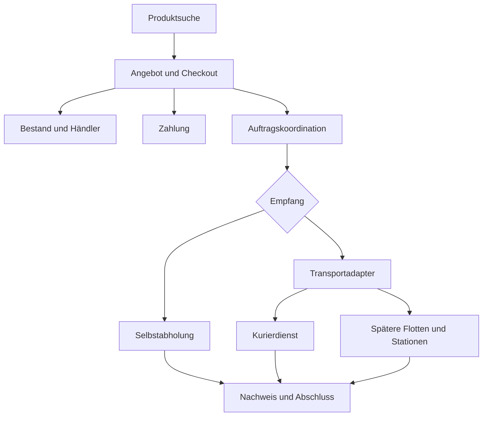

# Lokale Lieferplattform

> Vollständige Arbeitsgrundlage für Produktkonzept und Vibecoding. Kapitel 1 bis 10 ordnen die Idee; Kapitel 11 bis 17 beschreiben die technische Umsetzung. Die enthaltenen Demo-Werte sind keine Betriebszusagen.


Produktkonzept und Grundlage für die Entwicklung · Version 1 · 21. Oktober 2026

Wir entwickeln eine Plattform, mit der Menschen verfügbare Produkte bei teilnehmenden Händlern finden, bestellen und liefern lassen oder selbst abholen. Die App verbindet einen lokalen Produktkatalog mit Bestandsdaten, Bezahlung und mehreren Lieferdiensten. Einzelhandel und Supermärkte nutzen denselben Bestellkern.

### Das zentrale Produktversprechen

Kunden sehen vor dem Kauf, wo ein konkreter Artikel verfügbar ist, was die Bestellung insgesamt kostet und wann sie voraussichtlich ankommt. Sehr kurze Lieferzeiten sind ein Ziel für geeignete lokale Bestellungen. Die App zeigt dafür ein berechnetes Zeitfenster; sie verspricht keine pauschale Lieferung in wenigen Minuten.

### Empfohlener Start

Die erste nutzbare Version konzentriert sich auf ein Pilotgebiet, ausgewählte Partnergeschäfte, eine Filiale pro Bestellung, menschliche Kuriere und Selbstabholung. Supermärkte können zunächst mit verpackten, ungekühlten Artikeln und festen Stückpreisen teilnehmen. Drohnen, autonome Fahrzeuge, Stationsnetze und längere Transportketten werden als Erweiterungen vorbereitet.

### Annahmen für dieses Konzept

- Deutschland beziehungsweise EU als vorläufiger Pilotkontext; deutsche Oberfläche, Euro und Anzeige der Ortszeit des Liefergebiets. Ein anderer Zielmarkt erfordert eine erneute Prüfung der Betriebsannahmen.

- Der Händler verkauft die Ware. Die Plattform vermittelt Bestellung und Lieferung; Zahlungsabwicklung und Abrechnung erfolgen über einen dafür geeigneten Dienstleister. Die konkrete Vertragsgestaltung ist vor einem echten Pilotbetrieb zu entscheiden.

- Der Händler oder ein ausdrücklich vereinbarter externer Picker stellt die Ware zusammen und verpackt sie. Im empfohlenen Pilotmodell übernimmt der Händler diesen Schritt.

- Eigenversand bedeutet hier: Privatpersonen geben ein eigenes Paket an einer kompatiblen Station auf. Diese Annahme ist vor der Umsetzung zu bestätigen.

### Ergebnis für das Vibecoding

Dieses Dokument beschreibt Produktlogik und Umfang. Die ergänzende Markdown-Datei enthält dasselbe Konzept sowie Datenmodell, Zustandsregeln, API-Verträge, Entwicklungstickets, Abnahmekriterien und einen direkt verwendbaren Startprompt. Es handelt sich um ein Konzept; eine App wurde damit noch nicht implementiert.

## 1 Fachliche Struktur und Rollen

Vier unabhängige Entscheidungen bestimmen eine Bestellung. Dadurch bleibt die Benutzeroberfläche verständlich, auch wenn später weitere Transportmittel hinzukommen.

| Dimension | Optionen | Regel |
| --- | --- | --- |
| Vorgang | Produktsuche und Kauf; später Eigenversand | Produktsuche ist auch ohne Bestellung möglich. |
| Empfang | Selbstabholung, Hausadresse, kompatible Station | Adresse und Empfangsart bestimmen die Lieferbarkeit. |
| Transport | Automatische Auswahl; Fahrrad, E-Scooter, Auto; später Drohne oder autonomes Kfz | Nur geeignete und verfügbare Optionen sind buchbar. Selbstabholung braucht keinen Transport. |
| Service | Standard, Express, später Terminfenster | Express ist eine priorisierte Leistung mit eigener Kapazität, kein bestimmtes Fahrzeug. |

### Kundinnen und Kunden

Suchen nach Produkt oder Bild, vergleichen Angebote, wählen Empfang und Service, bezahlen, verfolgen die Bestellung und melden Probleme. Selbstabholer können nur recherchieren oder verbindlich bestellen. Eine bloße Suchanzeige reserviert noch keine Ware.

### Händler und Filialmitarbeiter

Stellen Sortiment, Preise, Bestände, Öffnungszeiten und Vorbereitungszeiten bereit. Sie bestätigen Bestellungen, stellen Ware zusammen, verpacken sie und geben sie an der Warenausgabe heraus. Ein Händler kann mehrere Filialen mit unterschiedlichen Beständen besitzen.

### Kuriere und Transportpartner

Melden Einsatzbereitschaft und Transportkapazität, übernehmen Aufträge, bestätigen Übernahmen und Zustellungen. Beschäftigungsmodell, Vergütung und Versicherung sind Betriebsentscheidungen; die App kann Minijobs unterstützen, setzt sie aber nicht automatisch voraus.

### Plattformbetrieb und Support

Verwalten Partner, Liefergebiete und Preisregeln. Sie ordnen im Pilotbetrieb Lieferungen bei Bedarf manuell zu, bearbeiten Störungen, Erstattungen und Streitfälle. Später liefern Stations- und Flottenbetreiber über Schnittstellen Kapazitäts- und Statusmeldungen.

### Auswahl der Liefermethode

Standardmäßig wählt das System eine passende Methode. Kunden können eine Präferenz angeben. Eine verbindlich zugesagte Methode darf nur nach den vereinbarten Wechselregeln geändert werden. Eine Drohne liefert an einen freigegebenen Übergabeort; Haustür oder Wohnungstür sind nicht automatisch geeignete Landeplätze.

## 2 Produktsuche und Bestandsdaten

### Suche und Vergleich

Die Suche startet mit Adresse oder freiwilliger Standortfreigabe. Kunden suchen nach Name, Kategorie, Marke oder später per Foto. Ergebnisse zeigen Produktvariante, Händler und Filiale, Warenpreis, Bestandsstatus, Entfernung sowie geschätzte Abhol- oder Lieferzeit. Nach Eingabe des Ziels erscheint der voraussichtliche Gesamtpreis.

- Filter: Kategorie, Preis, Radius, Verfügbarkeit, geöffnete Filiale, Selbstabholung, Lieferbarkeit und gewünschtes Zeitfenster. Transportfilter erscheinen nur, wenn die Methode für das Produkt und Ziel angeboten wird.

- Sortierung: schnellste Ankunft, niedrigster Gesamtpreis oder nächste Filiale. Entfernung allein bestimmt weder Fahrtzeit noch Kosten. Bei mehreren Artikeln wird die Auswahl für den vollständigen Warenkorb geprüft.

- Ohne Standortfreigabe funktioniert eine manuell eingegebene Adresse. Ein größerer Radius kann mehr Treffer liefern, muss aber längere Zeiten und höhere Kosten sichtbar machen.

### Produkt und Händlerangebot trennen

Ein Produkt beschreibt zum Beispiel ein bestimmtes USB-C-Kabel in einer konkreten Länge. Ein Angebot ergänzt Filiale, Preis, SKU und Verfügbarkeit. Varianten werden nicht gleichgesetzt. GTIN beziehungsweise EAN helfen beim Abgleich; Händler ohne standardisierte Artikelnummern benötigen eine Zuordnung.

### Zuverlässige Bestandsanzeige

Die Anbindung läuft über freigegebene Warenwirtschafts- oder Kassenschnittstellen. Webhooks sind bevorzugt; periodischer Abruf oder CSV und Händlerpflege dienen als Einstieg. Jeder Bestand hat Quelle, Zeitstempel und Qualitätsstatus. Kunden sehen verfügbar, wenige verfügbar, nicht verfügbar oder unbestätigt. Exakte Stückzahlen zeigt die App nur, wenn der Händler dies freigibt.

Vor dem Kauf wird erneut geprüft und zeitlich begrenzt reserviert. Veraltete oder unklare Bestände sind im Pilot nicht sofort verbindlich buchbar. Eine Reservierung in der App schützt allein nicht vor parallelen Verkäufen an der Kasse: Dafür braucht es eine gemeinsame Bestandsführung, ein separates Onlinekontingent oder eine verbindliche Händlerbestätigung.

### Große Anbieter und KI Bildersuche

Amazon ist eine mögliche spätere Partnerintegration. Die dokumentierte FBA-Schnittstelle liefert Bestandszusammenfassungen für Verkäuferartikel; SP-API-Zugriff erfolgt im Rahmen autorisierter Partnerdaten. Daraus folgt für dieses Konzept: kein frei verfügbarer Gesamtbestand von Amazon und kein zugesagter Abholzugriff auf dessen Lager. [1, 2]

Die Bildersuche liefert Kandidaten aus dem tatsächlich eingebundenen Katalog. Nutzer bestätigen den Treffer und die Variante. Bildähnlichkeit beweist weder Identität noch Lagerbestand. Fotos werden nur für diesen Zweck verarbeitet und nach einer festgelegten Frist gelöscht.

## 3 Bestellung Zahlung und Zustellung

### Der zentrale Bestellablauf

- 1. Ziel eingeben, Produkt suchen und konkretes Filialangebot auswählen. Im Pilot gehören alle Artikel eines Warenkorbs zu derselben Filiale.

- 2. Empfangsart und Service wählen. Das System prüft Produktmaße, Gewicht, Bestand, Geschäftszeiten, Vorbereitung, Liefergebiet und verfügbare Transportkapazität.

- 3. Ein befristetes Angebot zeigt Endpreis, Gebühren, Lieferzeitfenster, Methode beziehungsweise Auswahlregel und Bedingungen. Änderungen am Warenkorb oder Ziel machen es ungültig.

- 4. Der Server prüft das Angebot erneut, reserviert Bestand und autorisiert die Zahlung. Die Bestellung bleibt zunächst ausstehend. Preis und Bestellung entstehen serverseitig; ein Doppelklick erzeugt keine zweite Bestellung.

- 5. Händler bestätigt Ware und Vorbereitung. Bei Lieferung wird außerdem Kapazität verbindlich zugeordnet. Erst wenn diese Bedingungen erfüllt sind und der Zahlungseinzug erfolgreich ist, wird die Bestellung bestätigt.

- 6. Händler stellt zusammen, verpackt und meldet abholbereit. Der zugeordnete Kurier bestätigt die Übernahme per Auftragscode. Kunden sehen Status und aktualisiertes Ankunftsfenster.

- 7. Empfang wird per Einmalcode bestätigt. Bei Selbstabholung übernimmt der Kunde direkt an der Warenausgabe. Danach sind Bewertung, Beleg, Problemfall und erneute Bestellung erreichbar.

### Zahlung und Rückabwicklung

Der Pilot verwendet Zahlarten, bei denen Autorisierung und späterer Einzug unterstützt werden. Das ist beispielsweise für geeignete Zahlarten bei Stripe vorgesehen; Gültigkeitsdauer und Unterstützung sind zahlartabhängig. [3] Bei Ablehnung, fehlender Kapazität oder Ablauf vor dem Einzug werden Reservierungen und Autorisierung freigegeben. Nach Einzug erhält eine Rückabwicklung einen eigenen Erstattungsstatus.

Zahlungs-, Bestell- und Transportstatus werden getrennt gespeichert. Zahlungsprobleme dürfen nicht durch eine erfolgreiche Browserweiterleitung verdeckt werden. Bestätigte Ereignisse des Zahlungsdienstleisters und eine regelmäßige Abstimmung bestimmen den Zahlungsstatus.

### Verfolgung und Änderungen

Tracking zeigt zuerst eine nachvollziehbare Ereignisfolge. Eine Karte zeigt nur reale verfügbare Positionsdaten mit Aktualisierungszeitpunkt. Verspätungen aktualisieren die Schätzung und lösen bei Bedarf eine Nachricht aus. Die App erfindet keine Livebewegung.

Eine Umleitung wird später als Änderungsanfrage behandelt: Machbarkeit, Mehrkosten und neue Zeit prüfen, dem Kunden zur Zustimmung zeigen und erst nach Annahme durch den Transportpartner aktivieren. Das bisherige Ziel gilt weiter, bis der Wechsel bestätigt ist.

## 4 Händlerbetrieb Übergaben und Eigenversand

### Wenig Aufwand braucht einen definierten Prozess

Der digitale Ablauf reduziert Mehrfachpflege, Telefonate und manuelle Koordination. Physische Arbeit bleibt: Artikel finden, prüfen, verpacken und übergeben. Der Pilot nutzt Händler-Picking mit begrenztem Sortiment, einstellbarer Auftragskapazität und vorbereiteten Abholplätzen. Der Händler kann Annahmezeiten setzen, Aufträge pausieren und Überlastung melden.

Als Erweiterung kann ein externer Picker im Geschäft arbeiten. Zugang, Produktsuche, Qualität und Kosten müssen dann vereinbart sein. Ein automatisches Ausgabefach oder eine Drohnenstation reduziert den Übergabeaufwand, ersetzt aber das vorherige Befüllen nicht.

### Warenausgabe und Nachweis der Verantwortung

Jedes Paket hat eine eindeutige Kennung. Der Mitarbeiter prüft Bestellung und Empfängerberechtigung, scannt den Auftrag und bestätigt die Übergabe. Der Kurier bestätigt die Übernahme. Zeitpunkt, Beteiligte und Paketkennung werden protokolliert. Der Kurier sieht nur die für seinen Auftrag erforderlichen Daten.

### Stationen als eigene Infrastruktur

Stationen benötigen Fachgröße, freie Kapazität, Zugangszeiten, Standort, Betreiber und technischen Status. Ein Fach wird vor der Zusage reserviert. Einlagerung und Kundenabholung sind getrennte Ereignisse: In der Station angekommen bedeutet noch nicht vom Kunden empfangen.

QR-Code oder PIN berechtigen genau zur vorgesehenen Aktion am vorgesehenen Fach. Tokens sind kurz gültig, an Auftrag und Person gebunden und serverseitig nur einmal einlösbar. Fehlversuche werden begrenzt; ein Türsignal bestätigt noch keine Entnahme. Bei Defekt oder Verbindungsabbruch übernimmt ein protokollierter Supportprozess.

Mit Packstation ist im Konzept ein eigenes oder vertraglich angebundenes Netz gemeint. Eine bestimmte fremde Station wird erst nach bestätigter Partnerschaft und nutzbarer Schnittstelle angeboten. Kühlung, Fachgrößen und Öffnungszeiten beeinflussen ihre Eignung.

### Eigenversand als gesonderter Vorgang

Absender wählen Startstation, Zieladresse oder Zielstation, Paketgröße, Gewicht und Service. Nach Preisbestätigung und Zahlung erhalten sie einen Einlieferungscode. Der Transportauftrag startet erst nach nachgewiesener Einlagerung. Tracking, Zustellung und Rückführung nutzen denselben Transportkern wie Händlerbestellungen, aber keinen Produktwarenkorb.

Vor Einführung sind erlaubte Inhalte, Empfängerkontakt, Identifizierung, Verpackung, Haftung und Rückführung zu klären. Rücksendungen aus Käufen sind ein eigener Vorgang mit Bezug zur ursprünglichen Bestellung und werden nicht automatisch mit Eigenversand gleichgesetzt.

## 5 Funktionsumfang der ersten Version

P0 bezeichnet einen vollständig durchspielbaren Entwicklungsprototyp mit sichtbaren Demo-Daten. M1 bezeichnet den ersten echten Pilotbetrieb nach funktionierenden Partner-, Zahlungs- und Betriebsanbindungen. Ein Prototyp ist keine Zusage echter Lieferbarkeit.

| Bereich | Verhalten in M1 | Abgrenzung |
| --- | --- | --- |
| Suche | Textsuche, Kategorien, Umkreis und Filter | Gastzugang zur Suche; Standort auch manuell |
| Angebote | Filialpreis, Variante, Bestandsstatus und Aktualität | Nur teilnehmende Händler |
| Bestände | Eine reale Pilotanbindung oder Onlinekontingent; Reservierung | CSV und Pflege sind als unbestätigte Daten erkennbar |
| Warenkorb | Mehrere Artikel aus einer Filiale | Keine gemeinsame Bestellung aus mehreren Filialen |
| Empfang | Hausadresse oder Selbstabholung | Haus- versus Wohnungstür ausdrücklich anzeigen |
| Kuriere | Fahrrad, E-Scooter und Auto nach Eignung | Nur im Pilot tatsächlich verfügbare Arten aktivieren |
| Service | Sofortbestellung mit Standard; Express bei freier Kapazität | Express im P0 simulierbar, im Pilot nur bei belastbarem Angebot |
| Zahlung | Autorisierung, Einzug, Beleg und Erstattung | P0 ausschließlich simuliert; M1 über Zahlungsdienstleister |
| Konto | Anmeldung, Adressen, Historie und erneute Bestellung | Erneut bestellen prüft aktuelle Preise und Bestand |
| Verfolgung | Statusfolge, Zeitfenster und Statusnachrichten | Positionskarte nur bei verfügbarer Telemetrie |
| Feedback | Getrennte Händler- und Lieferbewertung | Nur nach abgeschlossenem, zugehörigem Auftrag |
| Händlerportal | Annehmen, ablehnen, vorbereiten und übergeben | Auftragslimit und Pause pro Filiale |
| Kurieransicht | Verfügbar melden, Auftrag, Übernahme und Zustellung | Zuweisung auch manuell durch Betrieb möglich |
| Support | Stornoanfragen, Problemfälle und Erstattungen | Berechtigte und protokollierte Aktionen |
| Bedienung | Responsive App, Hell- und Dunkelmodus | Lesbare Schrift, Tastatur- und Screenreaderbedienung |

Auch einfache Supermarktartikel können in M1 angeboten werden. Kühlware, lose Gewichtsware, altersbeschränkte und besonders regulierte Produkte bleiben aus dem Pilot, solange die nötigen Prozesse fehlen.

## 6 Ausbauplan für alle weiteren Ideen

A2 erweitert einen funktionierenden lokalen Betrieb. A3 umfasst Transportnetze und autonome Zustellung mit eigenen Partner- und Betriebsfreigaben. Die Reihenfolge ist eine Empfehlung, keine zugesagte Terminplanung.

| Idee | Stufe | Voraussetzung und Produktregel |
| --- | --- | --- |
| Lieferzeit auswählen | A2 | Buchbare Zeitfenster mit Kapazitätsprüfung; P0 zeigt spätere Slots als Demo. |
| KI Bildersuche | A2 | Suche in Partnerkatalogen; Treffer und Variante bestätigen lassen. |
| Station als Empfangsort | A2 | Partner oder eigenes Netz, Fachreservierung und Abholfrist. |
| QR und PIN für Stationen | A2 | Einmaltoken, Berechtigung, Türereignis und Störungsprozess. |
| Pakete umleiten | A2 | Vor definiertem Annahmeschluss; neuer Preis und neue ETA nur nach Zustimmung. |
| Eigenversand aus Stationen | A2 | Separater Versandauftrag; Einlagerung als Startnachweis. |
| Supermarkt vollständig | A2 | Kühlkette, Gewichtsartikel, Ersatzprodukte und Preisfreigabe. |
| Bestellungen bündeln | A2 | Gemeinsame Tour nur innerhalb zugesagter Zeiten und Kapazitäten. |
| Mehrere Händler pro Einkauf | A2 | Teilbestellungen, Teilkosten, Teilzahlungen und Ausfälle transparent. |
| Lange Strecken mit Zwischenstopps | A3 | Mehrere Transportabschnitte, Übergaben und erhöhte Kosten. |
| Weitere Großanbieter und Amazon | A2 oder A3 | Zugriffsrechte, nutzbare Bestandsdaten und tatsächliche Übergabemöglichkeit. |
| Drohnen zwischen festen Stationen | A3 | Geeignete Ware, Stationen, Betreiber und freigegebener Betrieb. |
| Drohnen direkt zu Kunden | A3 | Freigegebener, zur Drohne passender Übergabeplatz und aktuelle Machbarkeit. |
| Autonome Fahrzeuge | A3 | Betriebsgebiet, Partner, sichere Übergabe und Störungsablauf. |
| Automatische Warenausgabe | A3 | Geeignete Hardware; Befüllung und Paketprüfung bleiben zugeordnet. |

### Was bereits vorbereitet wird

Lieferangebote enthalten Transportart, Empfangsart, Service, Kosten, Zeitfenster und Einschränkungen getrennt. Transportpartner werden hinter austauschbaren Schnittstellen angebunden. Spätere Stationen und Teilstrecken werden im Modell berücksichtigt, ohne im ersten Schritt Flottensteuerung oder Flugnavigation zu bauen.

## 7 Bedienung Preise und Geschäftsmodell

### Oberflächen

Die Kunden-App führt von Start und Suche über Ergebnisliste, Produktvergleich, Warenkorb und Checkout zur Bestellverfolgung. Konto, Adressen, Historie, Bewertung und Hilfe sind eigene Bereiche. Später kommen Bildsuche, Stationsauswahl, Umleitung und Eigenversand hinzu. Die Hauptnavigation kann Suche, Bestellungen und Konto enthalten.

Das Händlerportal zeigt eine Arbeitsliste mit neuen, bestätigten, in Vorbereitung befindlichen und abholbereiten Aufträgen. Die Kurieransicht konzentriert sich auf Verfügbarkeit und aktuelle Lieferungen. Die Betriebsansicht zeigt Zuweisung, Ausnahmen, Erstattungen und Partnerstatus. Rollen werden nicht durch einen frei wählbaren Schalter in echten Konten gewechselt.

### Zugänglichkeit

Menschen mit eingeschränkter Mobilität profitieren von einer verlässlich beschriebenen Übergabe. Hauszugang, Etage und benötigte Unterstützung werden nur erhoben, soweit sie für den Auftrag nötig sind. Große Bedienelemente, klare Sprache, skalierbare Schrift und nicht ausschließlich farbliche Statusanzeigen gehören zur Basis. Eine Karte ist niemals der einzige Weg, eine Bestellung zu verstehen.

### Preis und Lieferzeit

Angezeigter Gesamtpreis = Warenwert + Liefergebühr + klar ausgewiesene Zusatzgebühren − Rabatte. Anwendbare Steuern und Pfand erscheinen nachvollziehbar. Station, Express, Wartezeit oder lange Strecken können eigene Preisbestandteile haben, die vor Abschluss sichtbar sind. Interne Transportkosten und Kundenpreis werden getrennt kalkuliert.

Die ETA ist ein Zeitfenster ab Bestellung: Bestätigung und Zusammenstellen der Ware, Anfahrt des Kuriers, Übergabe, Transport und Empfang bestimmen den Ablauf. Teilaufgaben können parallel laufen; daher zählt der tatsächliche kritische Pfad. Entfernung ist nur ein Einflussfaktor. Das Terminmodell prüft später zusätzlich, ob Vorbereitung und Transport in das gewählte Fenster passen.

### Erlöse und Wirtschaftlichkeit als Hypothesen

Denkbare Erlöse sind Händlerprovision, Liefer- oder Servicegebühr und später ein Händlerabo für Zusatzfunktionen. Konkrete Tarife bleiben offen. Pro Auftrag müssen Transportvergütung, Picking, Zahlungsgebühren, Stationsbetrieb, Support und erwartete Ausfallkosten berücksichtigt werden. Ein höherer Warenkorb macht eine unwirtschaftliche Lieferstrecke nicht automatisch rentabel.

Der Pilot misst Bestandsfehler, Stornogründe, Vorbereitungszeit, Zeit bis Zustellung, Anteil pünktlicher Aufträge, Händleraufwand, Wiederbestellungen und Deckungsbeitrag je Auftrag. Sehr kurze Lieferzeiten werden erst dann beworben, wenn sie im vorgesehenen Gebiet zuverlässig erreicht werden.

## 8 Verbindliche Regeln für Sonderfälle

| Situation | Vorgesehenes Verhalten |
| --- | --- |
| Bestand reicht nicht | Vor Bestätigung ablehnen und Reservierung lösen. Keine stillen Ersatzartikel; Kunde kann neu auswählen. |
| Händler reagiert nicht | Nach konfigurierter Frist auslaufen lassen; Kunde informieren und Zahlungsautorisierung aufheben. |
| Kein geeigneter Kurier | Kein verbindliches Sofortangebot. Nach Absage neue Option vorschlagen oder stornieren; nicht unbegrenzt warten. |
| Preis oder Angebot abgelaufen | Neu kalkulieren und Zustimmung einholen. Ein alter Browserzustand bestimmt nicht den Preis. |
| Zahlung unklar | Als ausstehend anzeigen, Dienstleister abgleichen und Übergabe sperren. Wiederholung darf keinen zweiten Einzug auslösen. |
| Kunde nicht erreichbar | Vereinbarten Kontakt- und Warteprozess starten. Sichere Rückführung oder freigegebene Ablage; kein unbestätigtes Zugestellt. |
| Wetter oder Partnerausfall | Machbarkeit neu prüfen. Gleichwertiger Ersatz nur nach vereinbarter Erlaubnis; Mehrpreis oder andere Empfangsart erfordern Zustimmung. |
| Storno nach Übergabe | Als Support- und Rückführungsfall behandeln. Bestand nicht automatisch wieder verkaufbar machen. |
| Station voll oder defekt | Alternative anbieten und neu bestätigen. Bei bereits eingelagerter Ware Zugriff und Support nachvollziehbar lösen. |
| Umleitung nicht angenommen | Bisherige Route bleibt verbindlich. Keine zweite unabhängige Lieferung erzeugen. |

### Datenschutz und Berechtigungen als Produktregeln

Kunden sehen ihre eigenen Aufträge, Händler nur ihre Filialen und Kuriere nur zugewiesene Fahrten. Zahlungsdaten liegen beim Zahlungsdienstleister. Genaue Adressen und Positionsdaten werden nur für die nötigen Aufgaben freigegeben; Zugriff, Aufbewahrung und Löschung werden festgelegt. Administrations- und Erstattungsaktionen sind protokolliert.

### Sicherer Zustellnachweis

Übergabe- und Empfangscodes haben verschiedene Zwecke. Sie werden nur berechtigten Personen angezeigt, nicht in Tracking-URLs gespeichert und nach Nutzung ungültig. Fehlerfälle bleiben nachvollziehbar. Eine Sicherheitsbelehrung für spätere Drohnen ist ein Teil des Betriebsprozesses; sie wird nicht als Ersatz für technische Sicherheit oder notwendige Freigaben eingeplant.

## 9 Umsetzung und Entscheidungen

### Schrittweise Entwicklung

- Schritt 1: Durchspielbarer Prototyp mit Beispieldaten. Kunden suchen, bestellen und verfolgen; Händler bestätigen; Kuriere übernehmen und stellen zu. Fehlbestand und Absage sind ebenfalls durchspielbar.

- Schritt 2: Dauerhafte Datenbank, echte Authentifizierung, Filialrechte, serverseitige Preise und atomare Reservierungen. Dieselbe Fachlogik funktioniert für Lieferung und Selbstabholung.

- Schritt 3: Zahlungsdienst im Testmodus, ein Bestandsadapter und Transportadapter. Ereignisse, Wiederholungen und Erstattungen werden nachvollziehbar verarbeitet.

- Schritt 4: Begrenzter Pilot mit realen Partnern, vorbereiteter Warenausgabe, erreichbarem Support und geprüften Abrechnungs- und Rückführungsabläufen.

- Schritt 5: Ausbau anhand der Pilotdaten. Zuerst verlässliche lokale Abläufe; danach Bildsuche, Terminfenster, Stationen und weitere Transportpartner.

### Empfohlene technische Form

Eine responsive Web-App beziehungsweise PWA mit TypeScript und gemeinsamem Backend reicht für den Anfang. Ein modularer Monolith trennt Katalog, Bestellung, Bestand, Zahlung und Transport im Code, ohne getrennte Microservices zu verlangen. PostgreSQL speichert Geschäftsdaten; Geodaten können mit PostGIS verarbeitet werden. Authentifizierung wird über einen etablierten Dienst eingebunden.

Adapter kapseln Bestand, Transport, Zahlung, Benachrichtigungen und spätere Stationen. Ein Hintergrundprozess verarbeitet Ereignisse und Wiederholungen. Versionierte Datenbankmigrationen, Testdaten und eine lokale Startanleitung gehören zum Projekt. Die konkrete Framework-Auswahl folgt dem vorhandenen Teamwissen; das Fachmodell bleibt davon unabhängig.

### Noch zu entscheiden

| Entscheidung | Arbeitsannahme bis zur Entscheidung |
| --- | --- |
| Pilotgebiet und erste Partner | Kleines lokales Gebiet mit ausgewählten Geschäften |
| Picking und Vergütung | Händler stellt zusammen; Aufwand wird gemessen und vertraglich geregelt |
| Zugriff auf Bestände | Eine belastbare Pilotanbindung oder separates Onlinekontingent |
| Kuriermodell und Zustellort | Menschlicher Dienst; genauer Übergabeumfang vor Buchung |
| Preis und Vertragspartner | Transparente Gebühren; Händler als Warenverkäufer |
| Eigenversand und Stationen | Privatversand als Ausbau; eigene oder angebundene Stationen |

Für einen Prototyp müssen diese Entscheidungen nicht alle vorliegen. Für echten Betrieb sind die betroffenen Annahmen mit Partnern und den zuständigen Fachleuten zu bestätigen.

## 10 Routing als spätere Abhängigkeit

Die folgenden Anforderungen bleiben außerhalb des Hauptumfangs. Die App fragt einen Transportdienst nach Machbarkeit, Preis und Zeit; der Transportdienst entscheidet über konkrete Fahrzeuge und Wege. Die App übernimmt keine sicherheitskritische Flugsteuerung.

| Anforderung | Berücksichtigung im Produkt |
| --- | --- |
| Schnellste geeignete Drohne | Verfügbarkeit, Entfernung, Nutzlast und Akku einschließlich betrieblicher Reserve prüfen; früheste erfüllbare Ankunft bewerten. |
| Kundenlieferungen verbinden | Tourenbündelung nur bei kompatiblen Paketen, Kapazitäten und zugesagten Zeitfenstern. |
| Wetter und Vorhersagen | Wetterdaten vor Angebot und Start prüfen; Änderungen können eine Option sperren oder eine neue ETA auslösen. |
| Feste Flugrouten | Stationen, Hubs und Anbieter als mögliche Knoten; jede Strecke und Übergabe separat verfügbar halten. |
| Dynamische Direktflüge | Nur durch einen dafür freigegebenen Betreiber und nach aktueller Prüfung der konkreten Mission. |
| Sicherer Landeplatz | Eignung nach Drohnentyp, Platzbedarf und Umgebung prüfen; Kundenangabe allein ist keine Freigabe. |
| Sicherheitsbelehrung | Versionsstand und Bestätigung speichern, verständliche Übergabeanweisungen zeigen. |
| Kollisionen und Sperrzonen | Flugsicherheit beim Flottensystem; aktuelle dauerhafte und temporäre Sperrungen berücksichtigen. |
| Lange Strecken und Stopps | Transportabschnitte mit Anschlüssen, Kapazität, Kosten und dokumentiertem Verantwortungswechsel. |

Für die angenommene EU-Perspektive nennt EASA Flüge außerhalb der Sichtweite als Beispiel der speziellen Kategorie. Dort ist grundsätzlich eine Betriebsgenehmigung erforderlich, mit geregelten Wegen über Standardszenarien oder LUC-Berechtigungen. Daraus leiten wir ab: autonome Lieferung ist eine eigene Betriebsintegration und kein bloßer zusätzlicher Checkout-Schalter. [4]

### Geprüfte Grundlagen

Abruf am 21. Oktober 2026. Die Quellen stützen die jeweils markierten Integrations- und Betriebsgrenzen; Umfang, Priorisierung und Geschäftsregeln sind Konzeptvorschläge.

[1] Amazon SP-API · Get inventory summaries
https://developer-docs.amazon.com/sp-api/docs/get-fba-inventory-summaries

[2] Amazon SP-API · Authorize Applications
https://developer-docs.amazon.com/sp-api/docs/authorizing-selling-partner-api-applications

[3] Stripe · Place a hold on a payment method
https://docs.stripe.com/payments/place-a-hold-on-a-payment-method

[4] EASA · Specific Category Civil Drones
https://www.easa.europa.eu/en/domains/drones-air-mobility/operating-drone/specific-category-civil-drones


---

## 11 Technische Arbeitsgrundlage

Dieser Teil konkretisiert die empfohlenen Produktentscheidungen für ein Coding-System. Interne Namen sind englisch, die Oberfläche ist deutsch. Angaben wie Fristen oder Seed-Daten sind Entwicklungsvorgaben, keine validierten Betriebszusagen. Bei Abweichungen gilt die Fachlogik dieses Dokuments; Änderungen daran sind in einem Entscheidungsprotokoll festzuhalten.

### Architekturentscheidung

Bei einem vorhandenen Repository dessen Stack beibehalten. Ohne Repository: TypeScript, Next.js für responsive Oberfläche und Server-Endpunkte, PostgreSQL für Geschäftsdaten und Migrationen. Geografische Suche kann mit PostGIS ergänzt werden. Eine einzige Anwendung mit fachlich getrennten Modulen ist der Ausgangspunkt. Native Apps, Microservices und eine eigene Navigationsengine gehören nicht zum ersten Auftrag.

Die Module heißen `identity`, `catalog`, `inventory`, `checkout`, `orders`, `payments`, `fulfillment`, `delivery`, `notifications` und `support`. Ein Hintergrundprozess verarbeitet die Outbox, ablaufende Reservierungen und Ereignisse externer Anbieter. Kritische Geschäftsregeln laufen auf dem Server. Der Browser übermittelt Absichten, keine verbindlichen Preise oder Zustände.

Provider-Verträge für `InventoryProvider`, `DeliveryProvider`, `PaymentProvider` und `NotificationProvider` werden zuerst mit deterministischen Demo-Adaptern implementiert. Ein späterer `LockerProvider` ergänzt Stationszugriff. Echte Zugangsdaten werden nicht benötigt, um den Bestellablauf zu entwickeln. Mock und Echtbetrieb bleiben in Oberfläche, Konfiguration und Daten klar erkennbar.

### Fachliche Aufteilung



Das Diagramm beschreibt Verantwortungsbereiche, keine zeitliche Aufrufreihenfolge. Die Bestätigungsbedingungen aus Kapitel 3 bleiben verbindlich.

## 12 Datenmodell

Alle Tabellen erhalten IDs und Erstellungs- beziehungsweise Änderungszeitpunkte. Geld wird in kleinsten Währungseinheiten als Integer mit Währung gespeichert, Mengen im Pilot als positive ganze Stückzahlen. Zeitpunkte werden in UTC gespeichert und in der Zeitzone des Liefergebiets angezeigt. Zugangsdaten und Codes werden nicht im Klartext protokolliert.

| Objekt | Wichtige Felder | Beziehung oder Regel |
| --- | --- | --- |
| User und RoleGrant | authSubject, role, merchantId, storeId | Kunde, Händler, Kurier oder Betrieb; Rechte serverseitig und mandantenbezogen |
| Address | ownerId, postalAddress, coordinates, instructions | Bestellungen erhalten einen unveränderlichen Adress-Snapshot |
| Merchant | name, partnerStatus, settlementReference | Eine Organisation mit mehreren Filialen |
| Store | merchantId, address, timezone, openingHours, pickupHours, preparationMinutes, orderCapacity | Aktive Aufträge und Öffnungszeiten bestimmen die Annahme |
| ProductVariant | title, brand, GTIN, category, attributes, weight, dimensions, handlingRequirements | Eine konkrete Variante; unbekannte Maße erlauben keinen ungeprüften Drohnenversand |
| Offer | storeId, variantId, merchantSku, unitPrice, taxClass, deposit, active | Verkaufbares Angebot genau einer Filiale |
| InventorySnapshot | offerId, sourceAvailable, sourceVersion, observedAt, quality | Adapter vereinheitlicht die Bedeutung des Quellbestands |
| InventoryReservation | orderId, offerId, quantity, expiresAt, state, externalReference | Temporäre Reservierung wird nach Bestätigung zur Zuteilung |
| Cart und CartLine | userId oder sessionId, storeId, offerId, quantity, version | Im MVP eine Filiale pro Warenkorb |
| Quote | cartVersion, destinationHash, fulfillmentMode, serviceLevel, methodPolicy, priceBreakdown, etaWindow, expiresAt | Angebotsinhalt nach Erstellung unveränderlich |
| CheckoutAttempt | userId, idempotencyKey, requestHash, orderId, state | Derselbe Schlüssel mit identischen Daten liefert dasselbe Ergebnis |
| Order und OrderLine | customerId, storeId, status, priceSnapshot, addressSnapshot, offerSnapshot | Historische Preise und Produkttexte bleiben erhalten |
| MerchantTask | orderId, status, acceptedAt, readyAt, handoverAt | Physische Vorbereitung getrennt vom Bestellstatus |
| Payment und Refund | orderId, providerReference, amount, status, authorizationExpiresAt | Mehrere Versuche möglich; nur eine erfolgreiche Zahlung pro Checkout |
| DeliveryJob | orderId, providerId, courierId, method, status, etaWindow, destinationVersion | Für Selbstabholung wird kein Lieferauftrag erzeugt |
| CourierAvailability | courierId, vehicleType, payloadCapacity, availability, lastSeenAt | Veraltete Verfügbarkeit darf keine feste Zusage erzeugen |
| HandoverToken | purpose, subjectId, allowedActor, tokenHash, expiresAt, usedAt | Einmalige Freigabe für Übernahme oder Empfang |
| TrackingEvent | deliveryJobId oder orderId, providerEventId, type, occurredAt, receivedAt, actor | Append-only; externe Ereignisse werden dedupliziert |
| Review und SupportCase | orderId, authorId, target, rating oder reason, status | Nur berechtigte Beteiligte; Bewertung nach Abschluss |
| AuditEvent und OutboxEvent | aggregateId, eventType, payload, processingState | Zustandsänderung und ausgehendes Ereignis gemeinsam speichern |

Erweiterungen erst bei Bedarf als echte Tabellen anlegen: `Station`, `Compartment`, `CompartmentReservation`, `Shipment` für Eigenversand, `DeliveryLeg` für Teilstrecken, `RedirectRequest` für Umleitungen sowie `ReturnRequest` für Rücksendungen. Der Transportadapter wird so gestaltet, dass ein Auftrag später auf Kauf oder Eigenversand verweisen kann.

### Bestandsregeln

Für das Pilotmodell mit eigenem Onlinekontingent gilt: verfügbar = zugeteiltes Kontingent minus aktive Reservierungen minus bestätigte Zuteilungen. Eine Datenbanktransaktion mit Sperre beziehungsweise bedingtem Update verhindert negative Verfügbarkeit. Zwei Kunden dürfen den letzten Artikel nicht gleichzeitig reservieren.

Bei einem späteren externen Reservierungssystem legt der Adapter fest, ob dessen verfügbare Menge lokale Reservierungen bereits enthält. Dieselbe Reservierung darf nicht zweimal abgezogen werden. Jede externe Reservierung erhält eine Referenz; ältere Bestandsereignisse dürfen neuere Versionen nicht überschreiben. Ein lokaler Lock garantiert keine Synchronität mit der Ladenkasse.

Temporäre Reservierungen laufen nur während der ausstehenden Bestellung ab. Nach Bestätigung werden sie in eine dauerhafte Zuteilung umgewandelt. Nach Verkauf beziehungsweise Übergabe werden sie verbraucht. Bei Storno vor Übergabe können sie freigegeben werden; nach einer Rücksendung ist eine Warenprüfung nötig.

## 13 Zustände und Transaktionsregeln

Ein einziges Feld wie `orderStatus = delivered` reicht für Zahlung, Vorbereitung und Transport nicht aus. Die UI erzeugt aus mehreren Zuständen eine verständliche Zeitleiste.

| Bereich | Normaler Ablauf | Abweichungen |
| --- | --- | --- |
| Bestellung | PENDING → CONFIRMED → FULFILLING → COMPLETED | REJECTED oder EXPIRED aus PENDING; CANCELLED über geprüften Stornoprozess |
| Vorbereitung | NEW → ACCEPTED → PICKING → READY → HANDED_OVER | REJECTED vor Bestätigung; danach Supportfall oder definierter Abbruch |
| Bestand | ACTIVE → ALLOCATED → CONSUMED | RELEASED oder EXPIRED; ALLOCATED läuft nicht durch den normalen Reservierungstimer ab |
| Zahlung | PENDING → AUTHORIZED → CAPTURE_PENDING → CAPTURED | FAILED, VOID_PENDING, VOIDED; unbekannt bleibt ausstehend bis zur Klärung |
| Erstattung | REQUESTED → PROCESSING → SUCCEEDED | FAILED mit Wiederholung oder Support; Zahlungsstatus CAPTURED bleibt historisch korrekt |
| Lieferung | CREATED → ASSIGNED → PICKED_UP → IN_TRANSIT → AT_DESTINATION → DELIVERED | FAILED, RETURNING, RETURNED; CANCELLED nur vor Übernahme |

Die Pfeile beschreiben zugelassene Übergänge, keine frei editierbaren Statuswerte. `PENDING` enthält die noch offenen Bestätigungen. `FULFILLING` umfasst Vorbereitung und Transport. Ein fehlgeschlagener Transport schließt den Auftrag nicht automatisch ab. Der Supportfall bleibt sichtbar, bis erneute Zustellung oder Rückführung und finanzielle Behandlung feststehen.

### Bedingungen für Bestätigung und Übergabe

1. Checkout legt Bestellung, Reservierungen und Outbox-Ereignis atomar an. Netzaufrufe werden außerhalb der Datenbanktransaktion ausgeführt.
2. Zahlungsautorisierung, Händlerannahme und gegebenenfalls Transportzusage müssen vor Ablauf der Fristen vorliegen. Selbstabholung benötigt keine Kurierzusage.
3. Vor Einzug nochmals prüfen, dass Reservierung und Transportzusage noch gelten. Zahlung mit stabilem Idempotenzschlüssel einziehen. Erst nach bestätigtem Einzug Bestellung auf CONFIRMED und Bestand auf ALLOCATED setzen.
4. Bei einem Fehler zwischen Einzug und lokalem Commit gleicht ein Hintergrundprozess den Providerzustand ab. Während CAPTURE_PENDING oder eines unklaren Einzugs ist die Reservierung vor dem normalen Ablauf geschützt, bis Erfolg oder sicherer Abbruch geklärt sind. Es gibt keinen zweiten Einzug und keine automatische Freigabe bezahlter Ware wegen eines bloßen Timeouts. Dauerhaft ungeklärte Fälle werden an den Betrieb eskaliert.
5. PICKING ist erst nach Bestätigung erlaubt. READY plus CAPTURED plus zugeordneter Empfänger sind Voraussetzung für eine Übergabe. Bei Selbstabholung ist der Empfänger der Kunde.
6. Bei Lieferung schließen DELIVERED und gültiger Empfangsnachweis die Bestellung ab. Bei Selbstabholung genügt die dokumentierte Übergabe an den Kunden. Ein digitaler Code wird einmal eingelöst und anschließend abgewiesen.
7. Für spätere Stationen kommen AT_STATION und COLLECTED hinzu. Einlagerung beendet die Transportetappe, Kundenabholung erfüllt den Warenempfang. Fristablauf startet Rückführung statt einer erfundenen Abholung.

### Fehler und Abbruch

Vor Einzug: Reservierung und Kapazität lösen, Autorisierung aufheben und Kunden informieren. Nach Einzug: getrennten Erstattungsauftrag erstellen; Status bis zum tatsächlichen Ergebnis anzeigen. Nach Paketübernahme: zunächst Transport stoppen oder Rückführung vereinbaren, keine automatische Bestandsfreigabe.

Das MVP erlaubt einen direkten Stornoantrag, solange noch nicht PICKING begonnen hat. Danach entscheidet ein Supportablauf anhand des tatsächlichen Zustands. Diese Produktregel ersetzt keine anwendbaren Kundenrechte und ist vor Livebetrieb mit der Vertragsgestaltung abzugleichen. Kein Endpunkt darf eine Bestellung durch beliebiges Setzen von `status` umgehen.

## 14 Schnittstellen für das MVP

Die folgenden Pfade sind ein implementierbarer Vorschlag. Für alle Schreibaktionen gelten Authentifizierung, Rechteprüfung, Eingabevalidierung und ein protokollierter Akteur. Ausnahmen sind ausschließlich signierte Provider-Webhooks. Browser-IDs sind niemals ein Berechtigungsnachweis.

| Methode und Pfad | Zweck | Kernprüfung |
| --- | --- | --- |
| GET /api/catalog/search | Angebote nach Begriff, Radius und Filtern | Öffentliche Angebotsdaten, keine internen Bestände oder Privatadressen |
| GET /api/offers/:id | Variante, Filiale, Preis, Aktualität | Aktives Angebot und zulässige Datenfreigabe |
| PUT /api/cart | Positionen und Mengen ändern | Eine Filiale, gültige Mengen, Versionsprüfung |
| POST /api/quotes | Abholung und lieferbare Optionen kalkulieren | Aktueller Warenkorb, Ziel, Kapazität und Eignung |
| POST /api/checkout | Quote in ausstehende Bestellung überführen | Idempotenz, Ablaufzeit, Bestand, Nutzer und Preis-Snapshot |
| GET /api/orders/:id | Bestellung und Zeitleiste | Kunde, zugehöriger Händler oder berechtigter Betrieb |
| POST /api/orders/:id/cancel-requests | Storno beantragen | Zustand, Eigentümer und Rückabwicklungsregeln |
| POST /api/merchant/orders/:id/accept | Ware und Vorbereitungszeit bestätigen | Filialberechtigung, offene Frist und ausreichende Ware |
| POST /api/merchant/orders/:id/reject | Auftrag ablehnen | Grund und noch zulässiger Zustand |
| POST /api/merchant/orders/:id/start-picking | Zusammenstellen starten | Bestätigte Bestellung und Filialberechtigung |
| POST /api/merchant/orders/:id/ready | Abholbereit melden | Bestätigte Bestellung und abgeschlossene Vorbereitung |
| PUT /api/courier/availability | Einsatzstatus und Fahrzeug melden | Eigener Kurier, aktuelle Kapazität |
| POST /api/ops/jobs/:id/assign | Kurier verbindlich zuordnen | Kein Doppelauftrag, Paket geeignet, Kapazität verfügbar |
| POST /api/jobs/:id/pickup | Paketübernahme bestätigen | Zugeordneter Kurier und gültiger Händler-Übergabecode |
| POST /api/jobs/:id/deliver | Empfang bestätigen | Zulässiger Lieferzustand und gültiger Kunden-Empfangscode |
| POST /api/orders/:id/collect | Selbstabholung abschließen | Filialmitarbeiter, Kunde, Code, READY und CAPTURED |
| POST /api/orders/:id/reviews | Bewertung anlegen | Eigentümer und abgeschlossene Bestellung; Ziel getrennt speichern |
| POST /api/webhooks/:provider | Providerereignis übernehmen | Signatur, Ereignis-ID, Schema und zeitliche Plausibilität |
| POST /api/ops/refunds | Erstattung auslösen | Supportrecht, Betrag, Grund und keine doppelte Erstattung |

Listen für Händler, Kuriere und Betrieb verwenden dieselben Berechtigungsregeln. Zuweisung, Vorbereitung und Codeausgabe werden als kontrollierte Domain-Aktionen ergänzt, nicht als frei zugängliche Tabellenänderungen.

### Vertrag eines Lieferangebots

Das Beispiel ist vollständig fiktiv; Preis und Zeit sind keine Geschäftszusage. `validForSeconds` wird bei Erstellung serverseitig in `expiresAt` umgerechnet. Die zwei Zeitwerte bilden ein Ankunftsintervall ab Bestellung.

```json
{
  "quoteId": "demo_quote_001",
  "cartVersion": 3,
  "fulfillmentMode": "HOME_DELIVERY",
  "serviceLevel": "STANDARD",
  "methodPolicy": "AUTO_WITHIN_ACCEPTED_OPTIONS",
  "selectedMethod": "BICYCLE",
  "currency": "EUR",
  "itemsSubtotalMinor": 2490,
  "deliveryFeeMinor": 390,
  "serviceFeeMinor": 0,
  "totalMinor": 2880,
  "etaFromMinutes": 25,
  "etaToMinutes": 40,
  "validForSeconds": 120,
  "availability": "AVAILABLE",
  "isDemo": true
}
```

Für Selbstabholung sind Transportmethode und Liefergebühr leer beziehungsweise null Euro; die Zeitanzeige beschreibt Abholbereitschaft. Ein späteres Terminfenster wird als `requestedWindowStart` und `requestedWindowEnd` gespeichert. Für nicht verfügbare Optionen liefert der Server einen verständlichen Grund, zum Beispiel `OUT_OF_AREA`, `NO_CAPACITY`, `STORE_CLOSED`, `STOCK_UNCONFIRMED`, `PACKAGE_UNSUPPORTED` oder später `WEATHER_UNSAFE`.

Fehlerantworten enthalten `code`, `message`, `retryable` und `correlationId`. HTTP 409 gilt etwa bei Bestand, Warenkorbversion oder Idempotenzkonflikt; 422 bei unzulässiger Kombination; 403 bei fehlender Berechtigung. 202 bedeutet, dass eine asynchrone Aktion noch aussteht. Ein wiederholter identischer Checkout liefert die bereits erzeugte Bestellung.

## 15 Entwicklungsaufgaben mit Abnahme

Jede Aufgabe soll als kleiner, prüfbarer Schritt implementiert werden. Zuerst ein vollständiger Ablauf von Suche bis Empfang; zusätzliche Lieferarten folgen erst nach diesem Durchstich.

| Ticket | Ergebnis | Abnahme | Abhängigkeit |
| --- | --- | --- | --- |
| B01 Basis und Demo | App-Shell, deutsche Texte, Hell/Dunkel, Seed-Daten | Startanleitung funktioniert; Demo-Modus ist erkennbar | Keine |
| B02 Katalog und Suche | Angebote, Varianten, Filter, Filialvergleich | Suche ohne Standortfreigabe; Radius und Variante stimmen | B01 |
| B03 Konto und Daten | Migrationen, Authentifizierung, Rollen und Adressen | Kunde A kann Auftrag von B auch per API nicht lesen | B01 |
| B04 Warenkorb und Quote | Ein-Filial-Warenkorb, Abholung, Preis und ETA | Ziel- oder Warenkorbänderung verwirft alte Quote | B02, B03 |
| B05 Checkout und Bestand | Reservierung, Auftrag und Idempotenz | Zwei gleichzeitige Käufe der letzten Einheit ergeben höchstens einen Erfolg | B04 |
| B06 Händler und Zahlung | Annahme, Ablehnung, Capture, Ablauf und Refund | Keine Bestätigung vor allen Bedingungen; Ablehnung gibt Ressourcen frei | B05 |
| B07 Kurier und Empfang | Zuweisung, Übernahme, Tracking und Codes | Nur zugeordneter Kurier; Code nur einmal; Abholung ohne Kurier möglich | B06 |
| B08 Konto und Support | Historie, erneute Bestellung, Bewertung, Problemfall | Neue Bestellung nutzt neue Preise; Bewertung nur nach Abschluss | B07 |
| B09 Störungen und Betrieb | Outbox, Webhook-Prüfung, Wiederholung, Monitoring | Duplikate und vertauschte Ereignisse verfälschen keinen Endzustand | B06, B07 |
| B10 Pilotanbindung | Ein realer Bestandspartner, Zahlungsdienst und Kurierbetrieb | Durchgängiger beaufsichtigter Auftrag inklusive Rückabwicklung | B08, B09 und Partnerfreigaben |

P0 kann mit Demo-Identitäten beginnen. Spätestens B03 werden Berechtigungen tatsächlich serverseitig durchgesetzt. Ein bloßer Rollenschalter ist nur im klar abgegrenzten Entwicklungsmodus zulässig.

### Kritische Abnahmeszenarien

1. Ein Kunde findet einen Artikel in zwei Filialen; der Vergleich verwechselt die Variante nicht und unterscheidet Warenpreis und Gesamtpreis.
2. Ein Artikel einer zweiten Filiale wird nicht stillschweigend in den bestehenden Warenkorb aufgenommen; Wechsel oder separater Warenkorb wird erklärt.
3. Veralteter Bestand wird als unbestätigt angezeigt und erzeugt keine verbindliche Sofortzusage.
4. Zwei Checkouts für die letzte Einheit konkurrieren tatsächlich in getrennten Transaktionen; es entstehen keine negativen Bestände.
5. Doppelklick und Netzwerk-Wiederholung erzeugen eine Bestellung und höchstens einen erfolgreichen Einzug.
6. Eine abgelaufene Quote, geänderte Menge oder neue Lieferadresse verlangt eine Neuberechnung und erneute Zustimmung.
7. Händlerabsage, Fristablauf und fehlender Kurier lösen Reservierung und Autorisierung zuverlässig; eine bestätigte Zuteilung läuft nicht versehentlich ab.
8. Ein unbekannter Zahlungsstatus sperrt die Übergabe. Ein später Erfolg wird abgeglichen, ohne doppelte Belastung.
9. Selbstabholung funktioniert ohne DeliveryJob und ohne Liefergebühr, aber mit Vorbereitung und Empfangsnachweis.
10. Ein nicht zugeordneter Kurier kann weder die Zieladresse abrufen noch das Paket übernehmen.
11. Falscher, abgelaufener oder bereits verbrauchter Code wird abgewiesen; Zustellung ohne Nachweis wird nicht als erfolgreich angezeigt.
12. Doppelte oder verspätete Providerereignisse setzen DELIVERED nicht zurück auf IN_TRANSIT.
13. Kunde A, Händler A und Kurier A können fremde Aufträge weder lesen noch ändern; Erraten einer ID hilft nicht.
14. Ein Refund bleibt sichtbar ausstehend, bis der Zahlungsdienst Erfolg meldet; die Historie behauptet vorher keine erfolgte Rückzahlung.
15. Fehlgeschlagene Zustellung erzeugt einen bearbeitbaren Fall; Ware wird erst nach geprüfter Rückkehr wieder verfügbar.
16. Listen, Checkout und Tracking funktionieren auf einem kleinen Bildschirm, per Tastatur und mit lesbarem Hell- sowie Dunkelmodus.

Unit-Tests prüfen Preisberechnung, Zustandsregeln und Eignung. Integrationstests prüfen Transaktionen, Rechte, Outbox und Webhooks. End-to-End-Tests decken normale Lieferung, Selbstabholung und einen Abbruchfall ab. Tests sollen diese Risiken prüfen und nicht bloß Komponenten-Snapshots sammeln.

### Fiktive Daten zum Durchspielen

Seed: drei lokale Händler mit insgesamt vier Filialen, darunter ein Supermarkt; etwa 20 Varianten mit teilweise mehreren Angeboten; zwei Kunden; drei Kuriere mit Fahrrad, E-Scooter und Auto; ein Betriebsnutzer. Enthalten sind ein ausverkaufter Artikel, die letzte verfügbare Einheit, ein veralteter Bestand, eine geschlossene Filiale, ein zu großes Paket und ein Ziel außerhalb des Gebiets.

Demo-Konfiguration: Quote 120 Sekunden, offene Bestandsreservierung 5 Minuten, Händlerantwort maximal 3 Minuten. Fristen dürfen für die Vorführung beschleunigt werden und müssen über eine kontrollierbare Uhr testbar sein. Für einen echten Pilot werden die Werte anhand der Partnerprozesse festgelegt. Auch die ETA-Spanne von 25 bis 40 Minuten aus dem Beispiel ist ausschließlich ein Testwert.

## 16 Startprompt für ein Coding-System

Den folgenden Text zusammen mit dieser vollständigen Datei verwenden. Er beauftragt die Entwicklung des MVP, nicht die automatische Veröffentlichung oder Inbetriebnahme realer Lieferdienste.

> Entwickle auf Grundlage dieser Spezifikation eine lokale Lieferplattform mit deutscher Oberfläche. Nutze das vorhandene Repository und dessen Konventionen. Falls es noch keines gibt, beginne mit TypeScript, Next.js und PostgreSQL als modularer Anwendung. Verwende versionierte Migrationen und nachvollziehbare Seed-Daten.
>
> Implementiere zuerst einen vollständig durchspielbaren Ablauf: Produktsuche → Filialangebot → Warenkorb → befristetes Angebot → Checkout mit Reservierung → Händlerannahme und Transportzusage → Zahlungsbestätigung → Vorbereitung → Übernahme → Empfang. Selbstabholung muss denselben Bestellkern ohne Lieferauftrag verwenden.
>
> Der Startumfang ist eine Filiale pro Warenkorb, menschliche Kuriere und Selbstabholung. Trenne Transportmethode, Empfangsart und Servicelevel. Kunden sehen konkrete Preise, Bestandsaktualität und geschätzte Ankunftsfenster. Die Behauptung einer pauschalen Lieferung in wenigen Minuten ist nicht Teil des MVP.
>
> Baue Kundenoberfläche, Händlerarbeitsliste, Kurieransicht und einfache Betriebsansicht. Ergänze Konto, Adressen, Historie, erneute Bestellung, Bewertung und Problemfälle. Gestalte responsiv, gut lesbar und mit Hell- und Dunkelmodus. Zeige Karten nur, wenn echte beziehungsweise ausdrücklich markierte simulierte Daten vorliegen.
>
> Verwende austauschbare Demo-Adapter für Bestand, Zahlung, Transport und Benachrichtigungen. Simuliere Erfolg, Ablehnung, Timeout und Wiederholung kontrollierbar. Baue keine echten Drohnen-, Fahrzeug- oder Stationssteuerungen. Vermerke spätere Erweiterungen als Backlog und Feature-Flags, ohne nicht verfügbare Leistungen buchbar zu machen.
>
> Implementiere die Fachobjekte und Zustandsregeln aus Kapitel 12 und 13. Preise werden serverseitig berechnet. Reservierungen sind atomar. Checkout, Capture und Refund sind idempotent. Bestell-, Vorbereitungs-, Zahlungs- und Transportstatus sind getrennt. Bestätigte Reservierungen laufen nicht wie offene Checkout-Reservierungen ab.
>
> Sichere alle Endpunkte serverseitig nach Nutzer, Händlerfiliale und zugeordnetem Kurier ab. Keine API-Schlüssel im Browser, keine privaten Adressen in öffentlichen Listen, keine frei manipulierbaren Statusfelder. Übergabe- und Empfangscodes haben getrennte Zwecke, begrenzte Gültigkeit und Einmalverwendung. Prüfe Signaturen und Ereignis-IDs an echten Webhooks, sobald diese Adapter angeschlossen werden.
>
> Setze die Tickets B01 bis B09 in überprüfbaren Schritten um. B10 wird vorbereitet und erst mit realen Partnerzugängen aktiviert. Nach jedem Schritt nenne kurz das implementierte Verhalten, die relevanten Prüfungen und die offenen Abhängigkeiten. Lege ein Entscheidungsprotokoll an und ändere Fachregeln nicht stillschweigend.
>
> Liefere zum Abschluss Startanleitung, Migrationen, Seed-Daten, dokumentierte Demo-Zugänge beziehungsweise Rollen, eine Konfigurationsvorlage ohne Geheimnisse und die Ergebnisse der kritischen Abnahmeszenarien. Weise klar aus, welche Integrationen simuliert sind. Der Prototyp soll ohne externe Liefer-, Zahlungs- oder Flottenzugänge vorführbar sein.

## 17 Entscheidungen vor einem echten Pilot

Die nächsten praktischen Gespräche betreffen drei Dinge: Welcher Händler bestätigt Bestand und stellt Ware zusammen? Wer übernimmt Transport und fehlgeschlagene Zustellungen? Welche Kosten und Lieferzeiten ergeben sich daraus tatsächlich?

Erst daraus werden Liefergebiet, Annahmefristen, Kundenpreis und beworbene Geschwindigkeit festgelegt. Deutschland/EU, Händler-Picking und Eigenversand durch Privatpersonen sind die ausdrücklich markierten Arbeitsannahmen. Alle ursprünglichen Ideen sind im MVP, Ausbauplan oder Routing-Anhang enthalten; keine spätere Funktion ist als bereits verfügbar dargestellt.
